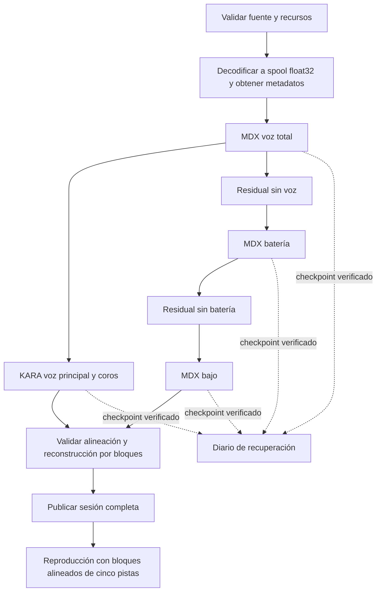

# Plan de implementación: cierre de migración y mejora del motor nativo

Fecha: 27 de octubre de 2026. Estado: **plan para revisión; no implementado todavía**.
Base comprobada: `8528d1a`, rama `feature/complete-python-migration`.

## 1. Objetivo y prioridades

Completar la paridad útil con la aplicación anterior y mejorar calidad,
estabilidad y consumo de recursos sin introducir regresiones de extracción.
La calidad de cada stem, la sincronización y la conservación de los originales
tienen prioridad sobre el tiempo de procesamiento. La velocidad se optimiza
después de establecer una referencia reproducible.

Toda la implementación, los nuevos bancos de pruebas y las herramientas de
desarrollo del repositorio serán Rust, Dart o PowerShell. No añadir `.py`, un
intérprete, PyTorch ni paquetes Python. El repositorio anterior y sus resultados
son una referencia externa; la aplicación nueva debe funcionar sin él.

Decisiones de alcance:

- Obligatorio para cerrar la migración: audio largo, reproducción sincronizada,
  resultados parciales recuperables, preferencias históricas, medidores por
  pista, reutilización de renders, política de recursos y distribución probada.
- Obligatorio para validar mejoras: corpus musical, métricas, escucha comparada,
  datos de RAM/tiempo y pruebas de hardware.
- Mejora del motor nuevo: GPU calificada, perfiles de calidad y diagnóstico del
  proveedor efectivo. Puede habilitarse por proveedor/modelo tras su validación;
  la ruta CPU debe seguir siendo completa y autónoma.
- Opcional y fuera del cierre de paridad: guardar automáticamente toda la edición
  de mezcla/posición, restaurar el último pitch al iniciar, pitch neuronal,
  modelos nuevos, separación en tiempo real y procesamiento en la nube.

Una mejora opcional no impedirá declarar completa la migración CPU. Si se
promociona GPU como funcionalidad de la entrega, deberá superar sus propias
pruebas; una opción no calificada permanecerá deshabilitada y explicada.

## 2. Evidencia inicial y riesgos concretos

La base aprobó 56 pruebas Rust, 6 Flutter con el puente compilado y el build
Windows con sus DLL/herramientas. Las 74 pruebas Python se ejecutaron solamente
en el otro repositorio. No existe todavía una evaluación musical representativa
que demuestre equivalencia de extracción.

Equipo observado para la primera campaña: Ryzen 9 8945HS, 8 núcleos físicos y
16 procesadores lógicos; aproximadamente 15.3 GiB de RAM visible; Radeon 780M
y RTX 4060 Laptop. No se ha medido VRAM disponible, proveedor ONNX realmente
activo, estado térmico ni rendimiento sostenido. Estos datos describen este
equipo, no requisitos mínimos ni resultados extrapolables a otros equipos.

| Evidencia del código actual | Riesgo que el plan debe resolver |
|---|---|
| `mdx.rs` normaliza por el pico de toda su entrada y acumula salida/pesos completos | Normalizar cada bloque de disco por separado cambiaría la entrada neuronal; usar archivos no basta para acotar RAM |
| `separate_five_stems.rs` divide voces en ocho segundos y usa umbral fijo de −65 dBFS | Posibles discontinuidades, pérdida de colas o voces suaves; la suma exacta puede ocultar que la energía terminó en un stem incorrecto |
| Bleed gate con umbrales absolutos, activo en la composición | Debe justificarse con extracción y escucha, no solo con conservación de la suma |
| `OrtSessionPool` limita cantidad, pero no memoria retenida por referencias activas | LRU de dos entradas no demuestra un límite real de memoria |
| `Studio::separate` crea runtime/pool por trabajo y orquesta muchas responsabilidades | Repetición de carga y coordinación difícil de probar; separar composición de política de trabajos |
| Lectores independientes consumen muestras disponibles | Un underrun de una pista puede desplazarla respecto a las demás |
| Conversión de frecuencia de reproducción con interpolación lineal | Medir respuesta/aliasing; preparar conversión de calidad fuera del callback |
| Control de dispositivo descarta errores del stream | Falta propagar fallos de salida y recuperar la reproducción con estado explícito |
| UI interpreta algunos errores mediante texto | La recuperación necesita códigos y estados tipados; no depender de mensajes en inglés |

El benchmark Python guardado usa un único loop instrumental de 15.48 s y
documenta sus propias limitaciones. Sirve como antecedente, no como objetivo
universal ni como prueba de voz principal/coros.

## 3. Arquitectura objetivo y responsabilidades

Mantener el escritorio local modular existente; no introducir microservicios.
Los nombres siguientes son componentes **propuestos**, no APIs ya disponibles.

| Módulo | Responsabilidad y ubicación | Dependencias |
|---|---|---|
| `audio-evidence` | CLI/benchmarks Rust, corpus y reportes; `benchmarks/`, ejemplos de infraestructura | Adaptadores actuales; sin UI |
| `quality-policy` | Perfiles versionados de inferencia/postproceso, invariantes; dominio/aplicación | Dominio |
| `job-recovery` | DAG, estados, manifiesto de trabajo, validación/reanudación; aplicación + almacenamiento | `quality-policy` |
| `compute-runtime` | Presupuesto CPU/RAM, admisión, pool persistente y proveedor; aplicación + ONNX | `job-recovery` |
| `bounded-inference` | Fuentes por frames, spool, STFT/overlap incremental y escrituras; infraestructura | Los anteriores |
| `streaming-playback` | Lectura anticipada coordinada, resampling y transporte; infraestructura | Contratos de archivos/frames |
| `studio-parity` | FFI tipado, Riverpod, preferencias, pitch-cache y medidores | Trabajos + reproducción |
| `provider-qualification` | Pruebas CPU/DirectML/CUDA y selección efectiva | Evidencia + runtime |
| `release-validation` | Paquete, instalador, pruebas limpias y matriz de compatibilidad | Todos los obligatorios |

Dirección: dominio → contratos de aplicación → adaptadores → composición FFI →
presentación. ONNX, CPAL, filesystem y FFmpeg no entrarán al dominio. La UI
recibirá metadatos, estados y picos reducidos; el PCM permanecerá nativo.



Voz/coros y la rama de instrumentos son candidatas a concurrencia **después**
de disponer de voz total y residual válidos. Batería → residual → bajo es una
dependencia obligatoria. Nunca ejecutar bajo sobre una entrada distinta para
ahorrar tiempo sin declarar y evaluar ese cambio de algoritmo.

## 4. Política de calidad: referencia antes de optimización

### 4.1 Corpus y comparación

Crear un manifiesto local de audio con hash, licencia/permiso, sample rate,
canales, duración, papel de cada stem y separación de conjuntos de ajuste y
validación. No incorporar canciones ni pesos al historial Git.

- Pruebas sintéticas: impulso, silencio, senos/sweep, estéreo asimétrico,
  antífase, DC, señales cerca de Nyquist, material muy suave y transitorios.
- Corpus musical inicial propuesto: al menos 12 fragmentos diversos de
  20–60 s; incluir voz suave, solista, doblajes, armonías/coros, reverb, batería
  densa, bajo sostenido y mezclas complejas. Ampliarlo si no cubre un riesgo.
- Incluir canciones completas de 3–8 minutos y un archivo de 30–60 minutos
  para memoria, deriva y estabilidad; repetir audio solo sirve para estrés,
  no añade diversidad musical ni evidencia de calidad.
- Para puntuar aislamiento se necesitan stems de referencia conocidos. Un
  conjunto que solo tenga «voz total» no valida voz principal frente a coros.
  En mezclas sin ground truth usar comparación ciega y diagnóstico, sin inventar SDR.

Conservar tres referencias distintas: resultados externos de Python,
`native-v1` actual congelado y un perfil nativo de compatibilidad validado.
Las diferencias ya existentes entre Python/native-v1 se explicarán antes de
escoger la referencia de no regresión. No declarar a native-v1 equivalente a
Python por ser la implementación más reciente.

Registrar por stem: alineación/duración, desviación de amplitud, pico y energía,
SI-SDR cuando exista ground truth, fuga de otras fuentes, daño de transitorios,
colas y continuidad en límites de bloques. SI-SDR se complementa con mediciones
de ganancia porque por definición permite reescalado; tampoco sustituye la
escucha. La elección de métricas tendrá en cuenta las limitaciones descritas en
[SDR — half-baked or well done?](https://arxiv.org/abs/1811.02508).

En referencias silenciosas, donde SI-SDR puede ser indefinido, medir energía
residual/fuga y contabilizar esos casos por separado; no convertir NaN o infinito
en una puntuación favorable ni eliminarlos del informe sin explicación.

La escucha A/B usará fragmentos emparejados y presentación ciega; podrá ajustar
ganancia solo para comparar percepción, conservando archivos sin modificar para
las métricas de amplitud. Registrar votos/casos y decisiones, no «suena mejor»
sin ejemplos verificables. Separar el conjunto usado para ajustar umbrales del
conjunto final de validación.

### 4.2 Qué se mantiene fijo y qué se experimenta

Fijar hashes de modelos, precisión FP32, dimensiones nativas, layout complejo,
ventana, hop, compensación, inversión KARA, normalización y overlap para las
pruebas de concurrencia/memoria. Ordenar reducción y publicación por índices
globales; no sumar en orden de finalización de workers.

Auditar por separado compensación y mapeo KARA, segmentación vocal de ocho
segundos, VAD y bleed gate. Comparar activado/desactivado con el mismo corpus.
No promover VAD/bleed como «mejora de calidad» sin evidencia. Evitar puertas duras
que eliminen respiraciones, voces bajas o reverb; estudiar contexto solapado,
histeresis y transiciones suaves como candidatos, conservando la suma.

Perfiles propuestos: **Compatibilidad FP32** como referencia estable y
**Calidad evaluada** para cambios DSP aprobados. Un modo rápido se limita primero
a recursos; no reducirá overlap, contexto o precisión de forma oculta. FP16,
cuantización, nuevos pesos o ensembles requieren otro experimento versionado.

Cada cambio de DSP/modelo invalida únicamente sus checkpoints y descendientes;
no reutilizar resultados de VAD/gate/parámetros anteriores por coincidencia de nombre.

## 5. Hilos, sesiones y recursos

Más hilos no mejoran por sí mismos el aislamiento. La selección debe minimizar
tiempo y presión de recursos **sujeta** a los criterios de audio. Hay que controlar
paralelismo de ramas, pools internos de ONNX, FFT/Rayon, codecs y tareas de UI.
ONNX distingue concurrencia entre operadores y dentro de cada operador; sus
sesiones pueden competir mediante pools propios. Verificar las opciones disponibles
en el runtime fijado antes de usar las de la documentación actual de
[gestión de hilos de ONNX Runtime](https://onnxruntime.ai/docs/performance/tune-performance/threading.html).

### 5.1 Política propuesta

- Un coordinador de trabajos y un runtime de I/O persistentes. Un trabajo pesado
  de usuario admitido inicialmente; evitar separar, renderizar y exportar a plena
  CPU simultáneamente. Reproducción/UI tienen prioridad de disponibilidad.
- Pool persistente de sesiones con leases: no desalojar una sesión activa y
  contabilizar modelos, tensores, scratch, colas y memoria todavía retenida.
- Política tipada con presupuesto de CPU, RAM y sesiones, workers de ramas,
  intra/inter-op, proveedor, límites de I/O y razones de degradación. La política
  de admisión reside en aplicación; la detección/adaptación de plataforma, en infraestructura.
- El valor «auto» seleccionará una configuración medida para hardware/runtime/
  proveedor/modelo. Ante información desconocida: ruta conservadora secuencial.
- Si falta memoria para la siguiente rama: esperar, reducir concurrencia o usar
  spool; nunca recortar frecuencia, calidad o duración silenciosamente.
- Capturar consumo real y estimado por separado. Un límite de admisión no es
  una garantía del SO; abortar de forma recuperable ante presión no controlable.

### 5.2 Primera búsqueda en este equipo, no valores universales

Comparar una rama con 1/2/4/6/8 hilos intra-op y dos ramas con 1/2/3/4 hilos
por sesión. Inter-op secuencial como punto de partida; spinning deshabilitado
como candidato inicial, comparado con la referencia. Incluir configuración
automática original para medirla, no asumir que es mejor.

Como arranque conservador interactivo, probar presupuesto de seis núcleos
físicos: una rama × seis hilos o dos × tres. Es una heurística de admisión,
no afinidad obligatoria ni un número óptimo ya demostrado. Contar el hilo
llamador según la semántica de ONNX; no multiplicar inadvertidamente pools.
FFT/codecs comparten ese presupuesto cuando están activos al mismo tiempo.
Los 16 procesadores lógicos no equivalen a 16 núcleos físicos independientes.

Medir separado: caché fría, modelo cargado sin checkpoint y cache hit de etapa.
Usar release, alimentación/modo de energía registrados, sin pruebas paralelas
ajenas; una ejecución fría y al menos cinco calientes para configuraciones
finalistas. Reportar mediana, dispersión y casos lentos. No publicar p95/p99
estadísticamente convincentes a partir de cinco canciones.

## 6. Memoria acotada e inferencia por archivos

Sustituir el requisito de `AudioBufferF32` completo por una fuente de frames y
artefactos inmutables respaldados en disco. Mantener una ruta pequeña de memoria
como referencia y comparar ambas antes de activar la nueva por defecto.

1. Validar el audio **antes** de solicitar descargas costosas. Decodificar a
   spool float32, contar frames y calcular pico/hash durante escritura, sin
   conservar toda la señal en un `Vec`.
2. Cada entrada de etapa dispone de pico global conocido, o se hace una pasada
   de lectura para obtenerlo. **No normalizar por cada bloque de disco**: cambiaría
   la escala/contexto que recibe una red no lineal y podría producir bombeo.
3. Anclar la rejilla de inferencia al frame global cero de cada etapa. Un bloque
   de I/O no reinicia padding, Hann, reflexión, overlap ni contexto neuronal.
4. Mantener solo ventanas, pesos y acumuladores pendientes. Emitir frames al
   quedar cerradas todas sus contribuciones, conservando el orden determinista.
   Cubrir correctamente principio, final, colas cortas y entradas silenciosas.
5. Escribir voz, residuales y stems incrementalmente; reutilizar buffers FFT y
   evitar conversiones/copias entre `Vec`/DTOs. El mmap tendrá ventanas y política
   de residencia: mapear un archivo completo no demuestra RSS acotado.
6. Validar reconstrucción por bloques y registrar extremos sin saturar stems
   float para «corregirlos». Limitar al escuchar o convertir a PCM de forma explícita.

Objetivo arquitectónico: memoria proporcional a modelos activos + ventanas +
colas + caches acotadas; independiente de duración una vez fijados esos límites.
Para medir deriva, comparar entradas de 5/30/60 minutos con la misma política,
separando modelos, heaps y page cache. El presupuesto numérico se fija con el
perfilado de la fase 0; no se promete un límite arbitrario de 512 MiB.

Presupuestar también disco: un stem estéreo float32 a 44.1 kHz ocupa alrededor
de 352 800 bytes/s sin comprimir; cinco stems de una hora, unos 6.35 GB decimales,
antes de temporales/checkpoints. Reservar margen para publicación transaccional,
definir cuota/evicción sin borrar artefactos activos y fallar de forma recuperable
si no hay espacio. Para archivos que excedan RIFF/WAV clásico, decidir y probar
RF64 o fragmentación interna; no prometer duración ilimitada con el writer actual.

## 7. Reproducción sincronizada y calidad de salida

Preparar **bloques conjuntos de cinco pistas**, con frame inicial, cantidad,
frecuencia del dispositivo y generación del transporte. Puede haber varios
lectores internos, pero el coordinador solo publica un bloque cuando sus pistas
están alineadas. Cola SPSC acotada y buffers preasignados.

Ante underrun: emitir silencio o transición corta común a todas las pistas y
no consumir parcialmente el bloque lógico. Mantener explícitos reloj del
dispositivo y posición musical. El contador permite distinguir corte de salida
de pérdida de sincronía; una pista nunca avanza sola para disimular el problema.

Una búsqueda incrementa generación, cancela/reubica productores y descarta
bloques viejos. Esperar prebuffer de esa generación antes de reanudar. Pausa,
stop, fin de archivo y cambio de sesión comparten el mismo transporte.

Preparar conversión band-limited a la frecuencia del dispositivo fuera del
callback, con fase común a las pistas; evaluar la interpolación actual con
sweeps y música antes de sustituirla. Conservar el audio maestro a 44.1 kHz
para inferencia y los originales; el dispositivo a 48 kHz no cambia la sesión.

Callback: sin I/O, locks, ONNX, FFT, FFmpeg, espera de threads ni asignación o
liberación de buffers. No hacer que el último `Arc` libere almacenamiento grande
dentro del callback; retirar buffers desde control. Los errores de dispositivo
deben pasar a un canal acotado y convertirse en estado visible.

Medidores por pista/master calculados sobre muestras reales; comunicar valores
reducidos a UI a 20–30 Hz, separado del progreso de trabajo. Probar salida mono/
estéreo, formato nativo soportado y 44.1/48 kHz. Como criterio inicial propuesto,
p99 del callback < 50 % de la duración de su buffer y cero incumplimientos de
deadline durante la campaña definida; medir distribución con suficientes callbacks.

## 8. Recuperación, cancelación y preferencias

Definir diario versionado por trabajo con fuente/hash, perfil completo, runtime/
proveedor, etapas y artefactos verificados. Transiciones tipadas:

- Ejecución normal: `queued → running → completed | partial | failed`.
- Cancelación aceptada: `queued | running → cancelling → cancelled`.
- Reanudación: nuevo intento desde `partial | failed | cancelled`, con contador
  de intento y artefactos compatibles; nunca revivir respuestas del intento anterior.

Definir el punto de commit: una cancelación aceptada antes de él impide publicar
el resultado final. Si la publicación duradera ya terminó, responder que el
trabajo está completado y la cancelación llegó tarde. No cambiar de estado por
una respuesta obsoleta ni afirmar que se canceló un resultado ya publicado.

- Publicar checkpoints y estado mediante staging, flush y reemplazo atómico;
  probar fallo entre escritura de artefacto y actualización del diario.
- Marcar bloques completos, rechazar truncados/corruptos y validar padres.
  Corromper batería invalida batería/bajo/residual dependiente, no voz/coros.
- Una sesión completa y una salida parcial son tipos/estados diferentes. UI
  muestra qué pistas son válidas y qué falta; no presenta cuatro stems como cinco.
- Reanudar bajo política explícita. Cambios solo de hilos reutilizan resultados
  si el contrato numérico se mantiene; cambio de DSP/modelo invalida el subgrafo.
  Cambiar proveedor exige una política de compatibilidad registrada.
- Cancelación cooperativa entre ventanas de inferencia y operaciones de I/O;
  progreso y latencia de cancelación medidos. Si el runtime fijado permite abortar
  `Run`, validar limpieza y reutilización antes de activarlo. No prometer cancelación
  instantánea de un kernel. Proceso Rust aislado solo si se demuestra necesario.
- Testear cierre forzado, falta de espacio, permisos, salida desaparecida,
  fuente cambiada y pérdida de dispositivo. Mantener originales y sesión anterior.
- Migrar la carpeta de QSettings mediante API nativa Windows, con validación y
  fallback local, sin depender de Qt/Python; lectura idempotente y no destructiva.

Separar el `Studio` actual en coordinación de trabajos, servicio de sesiones y
fachada de reproducción. Mantener FFI como composición, regenerar con FRB 2.8.0
y exponer fallos tipados (`MissingModels`, `DecodeFailed`, `ResourceLimit`, etc.).
Riverpod asociará respuestas a job/generación y no borrará un estado ocupado por
el fallo de un control de mezcla ajeno al trabajo.

## 9. Pitch, cache y calificación GPU

Pitch sigue siendo offline y conserva tempo. Clave del render: hash del stem
original, semitonos, formantes, opciones DSP y versión/hash de FFmpeg/Rubber Band.
Evitar transposiciones acumulativas; validar todos los stems y publicar el lote.
Probar 0, ±1, ±7 y ±12 semitonos con material vocal y percusivo, duración,
alineación, transitorios y ausencia de regresión de tempo. Las opciones expuestas
deben cotejarse con el FFmpeg incluido; no asumir que expone todas las opciones
de la biblioteca. Referencia: [notas oficiales de Rubber Band](https://breakfastquay.com/rubberband/integration.html).

GPU se califica por modelo/proveedor/equipo, en FP32 primero:

- Enumerar adaptadores y proveedor efectivamente activo; no confundir el orden
  solicitado con ejecución acelerada. Registrar fallback y sus motivos.
- DirectML exige ejecución secuencial, memoria pattern deshabilitada y no admite
  `Run` concurrente sobre una misma sesión. Serializar su uso; probar sesiones
  distintas solo bajo presupuesto y evidencia de beneficio. Estas restricciones
  están en la [documentación oficial de DirectML](https://onnxruntime.ai/docs/execution-providers/DirectML-ExecutionProvider.html).
- CUDA requiere calificar las DLL realmente empaquetables, versiones y memoria;
  no asumir disponibilidad por existir una RTX. No descargar dependencias de GPU
  o cambiar el runtime fijado silenciosamente.
- Medir cómputo + transferencias + STFT + carga; comparar resultado por stem y
  extremo a extremo, también en laptop con GPU integrada y memoria compartida.
- Fallo/OOM: reiniciar desde artefacto verificado en CPU, invalidando el subgrafo
  según política; no mezclar proveedores dentro de una etapa sin registrarlo.

## 10. Fases, entregables y criterios de salida

| Fase | Trabajo y archivos principales | Criterio para avanzar |
|---|---|---|
| F0 — Evidencia | CLI Rust de benchmark, manifiesto de corpus, metadatos de runtime y RSS; `benchmarks/` y ejemplos/tests de infraestructura | Referencias reproducibles, diferencias Python/native explicadas, datos de canciones completas; sin cifras inventadas |
| F1 — Contrato de calidad | Perfil versionado; `domain`, `application/use_cases`, `mdx.rs`, `dsp.rs` | Compatibilidad validada; VAD/gate/contexto comparados; ningún cambio de calidad activado sin evidencia |
| F2 — Artefactos y recuperación | Puertos de trabajo/artefactos, diario transaccional, sesiones parciales; aplicación, `session_workspace.rs`, `cache.rs` | Reanudación correcta ante fallos inyectados, invalidación por dependencias y cancelación observable |
| F3 — Runtime y concurrencia | Política de recursos, pool persistente/leases, DAG con dos ramas; `onnx.rs`, nuevos adaptadores y composición | Política serial/paralela escogida por medición; sin regresión de audio ni sobresuscripción; límites probados bajo presión |
| F4 — Inferencia acotada | Fuentes por frames, spool y overlap incremental; `audio_tools.rs`, `mdx.rs`, puertos/use cases | Salida comparada con referencia, rejilla independiente del I/O, RAM no proporcional a duración, reanudación de bloques coherente |
| F5 — Reproducción | Bloques comunes, seek por generación, prebuffer, resampling, errores/métricas; `streamer.rs`, `playback.rs` | Cero deriva entre stems en estrés; callbacks dentro de presupuesto; memoria estable; dispositivos reales probados |
| F6 — Paridad de estudio | FFI/estado tipado, medidores individuales, preferencias y cache de pitch; `bootstrap_ffi`, Riverpod, workbench | Flujos completos desde UI y DLL; ausencia de respuestas obsoletas; pitch/export/recuperación sin alterar originales |
| F7 — GPU calificada | Detección efectiva, opciones por proveedor y comparativas | Cada proveedor habilitado supera audio/estabilidad/recursos; CPU conserva funcionalidad completa |
| F8 — Distribución y cierre | Scripts locales, instalador, notices y pruebas en Windows limpio | Instalación y uso sin Python/SDKs ni repositorio anterior; matriz y pendientes de entrega cerrados |

Orden preferente: F0 → F1 → F2 → F3 → F4 → F5 → F6 → F7 → F8.
Puede adelantarse lectura de preferencias o pruebas de dispositivo si no cambia
la referencia DSP. No adelantar optimizaciones neuronales a F0/F1. F7 es una
línea de mejora; F8 puede certificar primero una entrega CPU si GPU sigue sin calificar.

No fijar fechas por intuición: al terminar F0 estimar duración y esfuerzo con
los tiempos medidos, corpus disponible y riesgos de compatibilidad del runtime.

## 11. Criterios transversales y decisiones de aceptación

| Dimensión | Condición de aceptación |
|---|---|
| Integridad | Fuentes/modelos originales sin modificar; cinco tipos correctos, frames y canales alineados, valores finitos |
| Reconstrucción | Mantener inicialmente tolerancia existente de 1e-5 en PCM de trabajo; si una operación exige otra, justificarla antes de cambiar el test |
| Calidad musical | No regresión relevante por stem/caso frente a referencia aprobada; revisión ciega de voz suave, coros, transitorios y bordes |
| Cambio solo operativo | Mismos parámetros DSP; tolerancia de diferencias FP32 fijada con repeticiones en F0/F1, no relajada para hacer pasar el resultado |
| Cambio de algoritmo/proveedor | Métricas por stem y escucha; no aceptar una media global que esconda degradación de coros/bajo/otro subgrupo |
| Calidad frente a rendimiento | Se rechaza una aceleración que degrade extracción o sincronía, aunque mejore la mediana de tiempo |
| RAM | Sin crecimiento lineal con duración bajo política fija; presupuesto observado y estimado reportados por separado |
| Recuperación | Reinicio/cancelación no publican archivos incompletos; solo se reutilizan artefactos verificados y compatibles |
| Transporte | Posición común, sin deriva acumulada; ningún salto por bloques de generación vieja; underruns contados y estado explícito |
| Distribución | Windows limpio, instalación/actualización/desinstalación, rutas con espacios/acentos y carpeta no escribible; datos del usuario conservados |

Los umbrales perceptuales no se fijarán arbitrariamente a 0.1 dB para después
declarar equivalencia. F0 estima dispersión y cobertura; F1 documenta límites
por clase de audio antes de experimentar. Un caso difícil se conserva como
regresión aunque el promedio del corpus mejore. Sin corpus suficiente, la
calidad queda como evidencia pendiente, no como aprobada por inferencia.

## 12. Commits propuestos y ejecución local

Continuar en **una sola feature**, con commits que compilen y prueben su cambio.
Separar refactor de cambio de algoritmo; no rehacer todo en un commit final.
La lista es una división inicial, ajustable al tamaño real sin mezclar responsabilidades:

1. `test(bench): add native audio corpus runner and resource baseline`
2. `feat(audio): version inference and postprocessing quality profiles`
3. `fix(separation): preserve vocal context at segmentation boundaries` — solo tras demostrar el problema y la mejora.
4. `feat(jobs): add typed job states and recoverable artifact journal`
5. `feat(recovery): resume verified stages and invalidate dependent outputs`
6. `feat(runtime): introduce CPU and memory admission policy`
7. `refactor(onnx): keep leased sessions in a persistent bounded pool`
8. `feat(separation): schedule independent branches within the resource budget`
9. `feat(audio): decode and hash sources into bounded float spools`
10. `feat(mdx): stream deterministic overlap-add inference to disk`
11. `feat(playback): publish aligned multi-stem blocks with seek generations`
12. `feat(playback): prepare resampling and expose device failures`
13. `feat(mixer): add per-track meters without blocking the callback`
14. `feat(settings): adopt legacy project preferences through native Windows APIs`
15. `feat(pitch): reuse verified renders keyed by original audio and DSP version`
16. `feat(studio): expose typed recovery and resource states through FFI`
17. `test(gpu): qualify provider accuracy memory and end-to-end performance`
18. `feat(onnx): enable qualified providers with explicit CPU fallback`
19. `build(windows): validate the standalone installer and bundled runtimes`
20. `docs(migration): record release evidence and close the parity checklist`

Cada commit de lógica llevará la prueba correspondiente; primero reproducir
fallos relevantes. Cambios matemáticos añadirán muestras/fixtures sintéticos y
comparativas específicas. Mantener fuera de Git corpus, renders, pesos y binarios.

Comandos **ya disponibles** para comprobación local:

```powershell
cargo fmt --manifest-path rust_core/Cargo.toml --all -- --check
cargo clippy --manifest-path rust_core/Cargo.toml --workspace --all-targets -- -D warnings
cargo test --manifest-path rust_core/Cargo.toml --workspace
flutter analyze
flutter test
```

Para integración, configurar la DLL/FFmpeg compilados como indica
[la auditoría](migration-audit.md#verificación-reproducible) y ejecutar también
las pruebas opcionales. Los comandos del nuevo benchmark se documentarán al
crearlo en F0; no se presentan herramientas futuras como si ya existieran.

No crear PR, fusionar ramas ni ejecutar/añadir GitHub Actions. Verificar en local
y subir únicamente la feature autorizada con sus commits granulares.

## 13. Riesgos, alternativas y cierre

| Riesgo/alternativa | Decisión inicial | Evidencia que permitiría cambiarla |
|---|---|---|
| Maximizar hilos o GPU desde el comienzo | Rechazado; conservar referencia y medir | Una configuración acelera extremo a extremo sin degradar audio/UX/recursos |
| Normalización por bloque para ahorrar una pasada | Rechazada por cambio de entrada neuronal | Solo un perfil de algoritmo distinto, con evaluación propia |
| Mantener todo PCM en RAM | Solo referencia/casos pequeños | Admisión demuestra que cabe sin presión; nunca única ruta para audio largo |
| Dos ramas siempre paralelas | No; serial conservador y admisión medida | CPU/RAM y reproducción sostienen el beneficio en campaña definida |
| Proceso de cómputo Rust separado | Diferido: mayor complejidad de IPC y recuperación | Es necesario para cancelación dura o aislamiento de fallos nativos demostrado |
| Modelos nuevos/ensembles/FP16 | Diferidos | Licencias/hashes/dimensiones verificados y mejora reproducible en validación separada |
| Reemplazar Rubber Band por pitch en callback | Rechazado para el cierre actual | Otro requisito de producto y pruebas de tempo/formantes/latencia |
| Usar suma de stems como único indicador | Rechazado | Nunca basta para demostrar asignación correcta de fuentes |

Responsabilidades: dominio/aplicación mantienen invariantes y política;
infraestructura mantiene procesamiento y recursos; FFI compone; Flutter presenta
estados y controles. La revisión humana acepta calidad audible y promoción de
perfiles; las mediciones y artefactos deben estar preparados antes de esa revisión.

Se declara **migración CPU completa** cuando F0–F6 y F8 tienen evidencia aprobada,
el producto no necesita Python ni el repositorio anterior y no faltan capacidades
obligatorias de paridad. Se declara **mejora GPU disponible** por cada proveedor
que supere F7. No convertir tareas nuevas opcionales en un cierre indefinido.
