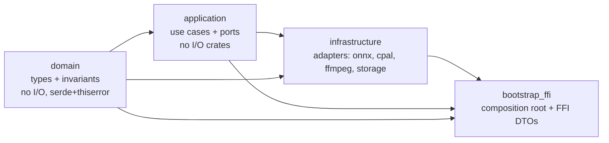
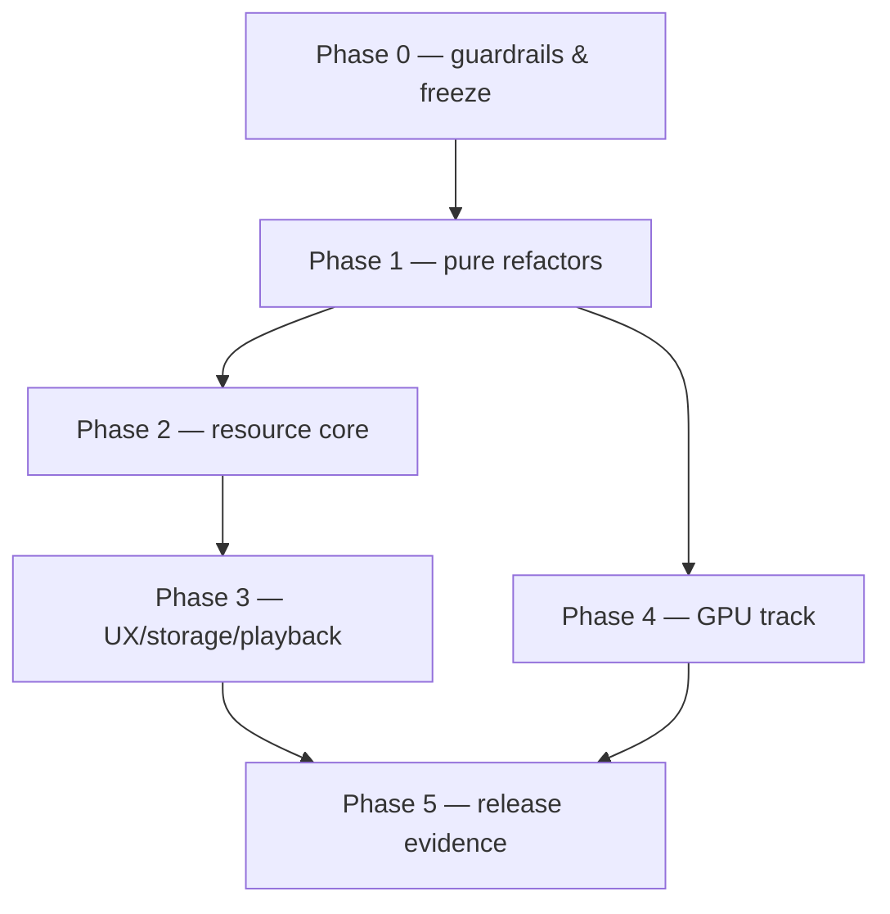

# Implementation plan — resource optimisation, maintainability and architecture enforcement

**Project:** Atomusicator 0.6.0 (Windows x64 CPU candidate) · Flutter UI + Rust engine
**Branch:** `feature/complete-python-migration`
**Baseline snapshot:** `243f287` + uncommitted work in progress (live-pitch feature) captured 2026-10-28 14:42 (America/Guayaquil). Line references are from that snapshot; the tree was being edited concurrently while this plan was written, so re-verify `file:line` anchors at implementation time.
**Companion evidence:** [`performance-resource-report.md`](performance-resource-report.md) (measured resources), `report/parts/{rust-engine,dart-storage,measurements}.md`, `report/maintainability/` (metrics and architecture audit for this plan).
**Status of this document:** plan only. No product code, dependency, model, packaging or CI change was made while producing it; nothing was committed or pushed.

---

## 0. How to read this plan

1. **§1–§3** state what the plan is for, what was measured, and the numeric targets that define success.
2. **§4** lists the invariants that no work package may violate (audio bit-exactness first among them).
3. **§5–§7** are the *verification* the owner asked for: Clean Architecture adherence, SOLID adherence and duplication, each with evidence and a verdict.
4. **§8** is the resource-optimisation backlog (CPU, GPU, RAM, I/O, storage) as ten work packages.
5. **§9** is the maintainability/architecture backlog as ten work packages.
6. **§10–§16** are the target architecture, sequencing/effort, commit plan, quality gates, risks and the decisions the owner must take.

Conventions: `WP-R*` = resource work package, `WP-M*` = maintainability work package; `CA-*`, `SOLID-*`, `DUP-*` = findings from the audits; effort `S` ≈ ≤1 dev-day, `M` ≈ 2–4, `L` ≈ 5–10, `XL` ≈ >10; **audio risk = none** means the frozen `native-v1` output must remain bit-identical (stems SHA-256 unchanged) after the change.

---

## 1. Executive summary

The engine's *runtime* behaviour is already good where it matters most: inference is duration-bounded in memory (peak RSS 1.41–1.50 GB regardless of song length or thread count), the realtime callback is clean, and the DSP is deterministic across thread counts. The weaknesses are **(a) how the available machine is used**, **(b) how much work is repeated**, and **(c) the structural debt that makes both hard to fix safely**.

**Diagnosis in one line:** the engine is a strictly serial chain of single-model inference calls with 42–49 % parallel efficiency and 16.5–20.4 s of fixed session-construction cost per pass, wrapped in a maintainability layer that still carries a parallel legacy implementation, a 883-line façade and about a dozen unused ports.

| Dimension | Measured today | Target after this plan |
|---|---|---|
| Separation wall time (3m45s song, same quality profile) | 418.1 s | **≤ 300 s** (−28 %) with wave 2, **≤ 250 s** (−40 %) with wave 3 |
| Parallel efficiency at 6 threads | 42–49 % | **≥ 65 %** (measured as CPU-seconds ÷ thread-seconds) |
| Fixed cost per pass | 16.5–20.4 s | **≤ 5 s** after first job in a process |
| Peak RSS (single separation) | 1.41–1.50 GB | **≤ 1.20 GB** default, **≤ 0.80 GB** compact profile |
| Session re-open (cache hit, 3m45s) | 5.77 s | **≤ 2.5 s** |
| Pitch job, 5 stems | serial, ~1 core | **≥ 2.5× faster**, bounded to the same CPU budget |
| GPU | none (CPU-only ORT, provider hardcoded) | **qualified or explicitly disabled with observability**; no silent fallback |
| Rust duplication (tokens) | **18.91 % overall / 17.02 % `src/`; Dart 13.33 %** (278 / 32 clone groups) | **≤ 6 % overall / ≤ 5 % `src`, ≤ 4 % Dart**, **≤ 1 % in new code** |
| Dead/legacy code shipped in DLL | whole-buffer MDX path, Symphonia/Hound decode-export, mmap cache, 9 dead or test-only ports (+2 bypassed) | **not shipped**; kept only as a test-only reference where needed |
| Largest source file | `playback.rs` 1 509 lines, `studio.rs` 995 lines; 17 functions > 100 lines (largest 292) | **≤ 600 lines hard limit, ≤ 80 lines per function** (ratchet with allow-list) |
| Quality gates | advisory: `fmt` red on 1 WIP file; `clippy -D warnings` red with 4 errors, **all in WIP files** (frozen code is clean); no duplication/architecture gate | **enforced locally before every commit** (§13); red only on in-flight code |
| Clean Architecture | dependency rule holds at crate level; enforcement is a 2-assertion test; 9 dead/test-only ports; stringly-typed FFI errors | **enforced by tests** (source-level imports + crate graph), no dead ports, typed error model |
| SOLID | SRP and OCP **violated**; LSP/ISP/DIP **at risk** (§6) | **documented verdicts + violations closed**, per-principle acceptance in §6.4 |

**Five decisive moves** (in order):

1. **Fill the idle CPU with useful work** — run independent inference concurrently inside the existing 6-thread budget (WP-R1), with the ORT global thread pool and optional physical-core affinity.
2. **Stop paying session construction on every job** — warm sessions and/or an ORT-optimised graph cache, and cache model verification (WP-R2, WP-R10).
3. **Stop re-reading what was just written** — verify-while-consuming, hash-during-write, waveform index from the spool (WP-R3).
4. **Use the whole machine for the non-neural work** — parallel FFmpeg for pitch/export (WP-R4) and a block-wise polyphase resampler (WP-R6).
5. **Remove the structural debt first, then optimise** — retire the legacy parallel implementation, split `Studio`, decompose `playback`, and make the quality/architecture gates executable (§7, §9, §13). Optimising a 1 509-line module with untyped errors is how regressions happen.

**Why this order:** the resource wins 1–4 do not change a single sample, but they touch the exact files that are hardest to reason about today. The plan therefore front-loads *guardrails* (Phase 0) and *pure refactors* (Phase 1), then lands the performance work on a codebase where a bit-exactness regression is caught automatically.

---

## 2. Baseline: what is measured (and what is not)

All numbers below are from the companion report and its artifacts; the plan does not re-derive them.

| Area | Fact | Evidence |
|---|---|---|
| End-to-end | 3m45.4s mix → 418.1 s wall, 1 597.4 CPU-s, peak RSS 1 460 MB, 6 intra-op threads | `local_audio/closure-evidence/applecats-bounded-*` |
| Thread scaling | 1→2→4→6 threads: 183.3 → 112.9 → 70.7 → 62.7 s; efficiency 81/65/49 %; CPU-seconds +28 % | `threads-{1,2,4,6}-result.json` |
| Fixed cost | a **2 s** input costs **22.0 s** per pass ⇒ F ≈ 16.5–20.4 s (≈4 ONNX session constructions) | `report/parts/measurements.md` §5 |
| Memory | flat 1.41–1.50 GB across 9.4× duration and 1–6 threads; FFT/OLA kernel flat at 40.5 MB over 5/30/60 min; ≈85–90 % is ORT arena, 114 MB weights | `kernel-*`, `threads-*` artifacts |
| CPU utilisation | 3.82 of 6 threads busy (full track); inference 97–99 % of wall; FFT/OLA 2.1 % | derived from CPU-s ÷ wall |
| Network work | 78.4 M network frames for 9.94 M audio frames (7.9×); KARA alone 30.3 M vs 15.4 M ideal (+19 %) | `domain/src/quality.rs:40-44` + window math |
| Re-open | 5.77 s cache hit moving ≈2.37 GB (spool verify 683 MB, publish read/write/hash 1 137 MB, waveform 379 MB, models 179 MB) | `applecats-final-cache-reopen.json` |
| Storage | release 489.3 MiB, installer 130.6 MiB, app cache 2.44 GiB, legacy sessions 7.88 GiB, 9 spools = 11.4 GB/h, admission 18.2 GB/h, measured write amplification 2.80× | report §5 |
| GPU | RTX 4060 Laptop 8 GB at 0 MiB / 0 %; CPU-only ORT; provider order hardcoded `[Cpu]`; effective provider never observed | `report/measurements/gpu/*`, `onnx.rs:40-41` |
| Verification | 115 passed / 0 failed / 8 ignored (default suite); 7/8 opt-in tests pass (one non-hermetic test fails on real-profile writes); stems bit-identical across 1/2/4/6 threads; reconstruction 2.98e-7 ≤ 1e-5 | `report/parts/measurements.md` §2, `threads-*-comparison.json` |

**Not measured (do not plan against guesses).** Per-model time split; per-session arena bytes; actual session-construction time inside the pipeline; callback deadline distribution (p50/p99); Flutter process RSS; pitch/export wall times; VRAM of any accelerated path. Every work package that depends on these numbers defines the measurement it needs *before* committing to a gain.

---

## 3. Objectives and acceptance metrics

### 3.1 Resource objectives

| ID | Objective | Metric | Baseline | Target | Gate |
|---|---|---|---|---|---|
| O-CPU-1 | Use the reserved thread budget | busy cores ÷ reserved threads during separation | 3.82/6 (64 %) | ≥ 4.5/6 (75 %) | median of 3 clean runs |
| O-CPU-2 | Faster end-to-end, same profile | wall seconds, 3m45s song | 418.1 | ≤ 300 (wave 2) / ≤ 250 (wave 3) | bit-identical stems |
| O-CPU-3 | Cut per-job fixed cost | wall, 2 s input | 22.0 | ≤ 7 s (≤ 5 s steady state) | stems + RSS |
| O-CPU-4 | No wasted CPU-seconds | CPU-s per audio-second | 7.08 (song) | ≤ 6.0 | same corpus |
| O-RAM-1 | Lower default peak | peak RSS (private) | 1.41–1.50 GB | ≤ 1.20 GB | stems |
| O-RAM-2 | Available on small machines | compact-profile peak | n/a | ≤ 0.80 GB | stems, documented trade-off |
| O-RAM-3 | Bounded with duration | peak RSS 5/30/60 min kernel | 40.5 MB flat | unchanged (regression only) | kernel bench |
| O-DISK-1 | Less read amplification | reopen wall / bytes moved | 5.77 s / 2.37 GB | ≤ 2.5 s / ≤ 1.3 GB | corruption tests still fail |
| O-DISK-2 | Predictable long-job storage | 60 min job disk | 10.9–11.4 GB + 18.2 GB admission | documented and enforced; no silent growth | long-run evidence |
| O-DISK-3 | No leaked temp state | `%TEMP%\.atomusicator-*` after 10 runs | 85 dirs / 27.75 MB (historical) | 0 | directory count |
| O-GPU-1 | No pretend acceleration | effective provider exposed in diagnostics and `session.json` | literal "CPUExecutionProvider" | ≥ 1 observable source of truth | test |
| O-GPU-2 | Qualification path exists | per-stem numeric diff + VRAM + sustained timing for DirectML on RTX 4060 | none | evidence pack or explicit "unqualified" decision | quality gate |
| O-FFMPEG-1 | Pitch/export use the machine | wall for 5-stem pitch / 5-stem export | serial, ~1 core | ≥ 2.5× faster, ≤ 3 concurrent children | output files bit-identical per track |

### 3.2 Maintainability / architecture objectives

| ID | Objective | Metric | Baseline | Target |
|---|---|---|---|---|
| O-DUP-1 | Duplication under control | token duplication, Rust / Dart | **18.91 % / 13.33 %** | ≤ 6 % / ≤ 4 % overall, ≤ 4 % product src, **≤ 1 % in new code** |
| O-QUAL-1 | Lint gates green | `cargo clippy -D warnings`, `cargo fmt --check`, `flutter analyze`, `dart format --set-exit-if-changed` | **Rust fmt: 1 WIP file fails; clippy: 4 warnings, all in WIP files (frozen code lint-clean at default lints); `dart format`: 26 files, 0 changed (PASS); `flutter analyze`: cannot run in the agent sandbox (analysis server `CreateFile failed 5`) — must be verified by the owner** | 0 errors, 0 warnings (WIP fixed at merge) |
| O-QUAL-2 | Bounded file/function size | largest file / function | **1 509 / 995 lines; 17 functions > 100 lines; largest function 292 lines** | ≤ 600 / ≤ 80 lines (ratchet, allow-list pays down) |
| O-QUAL-3 | No panic-prone code in production paths | `unwrap()/expect()` outside tests | **8 `unwrap` + 1 `expect` in production `src/`; 12 `unsafe` (documented/generated); 16 null assertions in Dart** | 0 `unwrap/expect` in non-test, non-example code; every `unsafe` documented and justified |
| O-QUAL-4 | Unused dependencies removed | declared-but-unused crates | `tracing`, `ndarray`, `apodize`, `memmap2` (legacy-only) | 0 (verified with `cargo machete`) |
| O-ARCH-1 | Dependency rule enforced | illegal imports found by test | 2-assertion test on Cargo.toml only | source-level test over `domain`, `application`, `infrastructure`, `bootstrap_ffi` |
| O-ARCH-2 | No dead ports | ports declared but never implemented/used | 4 (`SessionRepositoryPort`, `AudioFormatSelectionPort`, `SeparationStage`, `ProgressReporterPort`) + 7 legacy-only | 0 |
| O-ARCH-3 | Typed errors at the FFI boundary | `Result<_, String>` FFI functions | 12/12 in `studio.rs` | 0; one `UiErrorDto` with stable codes |
| O-ARCH-4 | Composition root only | concrete infra types outside `bootstrap_ffi` | 1 violation path to verify (§5) | 0 |
| O-SOLID-1 | SRP | types with >2 unrelated responsibilities | `Studio`, `MdxInference`, `playback.rs` types | 0 |
| O-SOLID-2 | OCP | files to touch to add a model / provider / export format | 3 files per format, 2 per provider, 3 per model | ≤ 2 per extension point, documented |
| O-SOLID-3 | DIP/ISP/LSP | see §6 | mostly PASS | PASS with evidence |

### 3.3 Definition of done (per work package)

A WP is done only when **all** of the following hold: behaviour tests added/updated; the audio bit-exactness gate passes (unless the WP explicitly changes a versioned profile); the resource metric was measured on a clean machine and recorded in the WP's evidence file; duplication and new-code coverage were reported for the touched code; `§13` gates are green; the commit(s) follow §12; and the WP's "rollback" was verified (feature flag or revert tested).

---

## 4. Invariants, constraints and non-goals

### 4.1 Hard invariants (violating any of these rejects the change)

1. **Audio identity.** For the frozen `native-v1` profile, the five published stems of the reference track must be **bit-identical** (SHA-256 per stem) before and after any refactor or scheduling change. The domain reconstruction contract `≤ 1e-5` (`domain/src/quality.rs:3`) is a *ceiling*, not the target.
2. **Thread-count invariance.** Results must not depend on the intra-op thread count or the number of concurrent runs. Any new concurrency must be covered by the existing invariance matrix extended to the new thread configuration (3, 4, 5, 6, 8…).
3. **No silent quality changes.** No FP16, quantisation, block re-normalisation, reduced overlap/window, different model bytes or ensemble may be introduced as an "optimisation". Changes to the DSP belong to a **new versioned profile** with its own evidence (`implementation-plans/native-migration.md` §4).
4. **Realtime safety.** The device callback must remain free of allocation, locks, I/O, subprocess work and unbounded waits; any change to the callback path must keep the existing `aligned_playback` tests and the documented checklist green.
5. **Originals untouched.** No work package may modify, overwrite or delete user originals, published sessions, `.job-owner` markers or the four model files.
6. **Cancellation and recovery semantics.** A cancelled job must still not publish; a crash must still be recoverable; caches must never evict leased artifacts.
7. **No hidden dependency or runtime changes.** ORT version, FRB 2.8.0 and lockfiles stay pinned unless the WP explicitly is a dependency WP with its own evidence.

### 4.2 Explicit non-goals

- Changing extraction quality, model weights, sample rate policy, or the five-stem topology.
- Making separation run while playback is active (today a job pauses playback, `studio.rs:139`); re-enabling that is a separate product decision with its own contention campaign.
- Cloud processing, Python, or the legacy repository.
- A cross-platform release; Windows x64 remains the only qualified target.
- Rewriting the UI; the plan only de-duplicates it and isolates repaint.

### 4.3 Working constraints

- The tree is under concurrent development (live-pitch WIP). **Phase 0 must freeze or merge that work before any WP touches `studio.rs`, `playback.rs`, `api.rs`, `studio_controller.dart`** — otherwise every commit conflicts.
- The agent environment cannot run the end-to-end harness (it resolves the real `%LOCALAPPDATA%` profile); the owner or a session with profile write access must run those gates.
- No push without explicit owner approval; commits are atomic, conventional and grouped by WP (§12).
- Every commit that changes performance must carry its measurement command and result in the commit body/evidence file.

---

## 5. Clean Architecture — verification verdict

**Method.** The audit checked the checklist in Appendix C against the crate graph (`Cargo.toml` per crate), `use` statements, the port inventory in `application/src/ports/mod.rs`, the FFI surface (`bootstrap_ffi`), the Flutter layering and the test seams. Every verdict below has a `file:line` anchor in [`report/maintainability/architecture-audit.md`](../report/maintainability/architecture-audit.md).

### 5.1 Verdict per rule

| # | Rule | Verdict | Evidence (summary) |
|---|---|---|---|
| CA-1 | `domain` depends only on serialisation/typed errors | **PASS** | `domain/Cargo.toml` = serde + thiserror only; asserted by `application/tests/architecture_boundaries.rs:22-38` |
| CA-2 | `application` depends only on `domain` + own ports | **PASS** | `application/Cargo.toml` has exactly one dependency; asserted at `architecture_boundaries.rs:8-19` |
| CA-3 | `infrastructure` implements ports, no inward dependency | **PASS** | 20 port impls in infrastructure; no application/domain import of infrastructure |
| CA-4 | `bootstrap_ffi` is the only composition root | **PASS (placement)** | concrete construction only at `studio.rs:52-88` (+ test factory) |
| CA-5 | Domain purity (no I/O concepts in the model) | **AT RISK** | `AudioAsset.path: PathBuf` (`domain/src/lib.rs:107-111`), stem assets (`:303-309`), infrastructure-flavoured error kinds (`:52-61`) |
| CA-6 | Ports minimal, cohesive, non-leaky | **AT RISK** | `Path` in ports; `VerifiedModelSpec.local_path` (`ports/mod.rs:151-159`); `as_any()` downcast (`:15` → `float_spool.rs:172`); 21 traits, **11 with no production consumer, 2 more bypassed** (§5.3) |
| CA-7 | FFI: DTOs only, typed errors, no audio logic in Flutter | **AT RISK** | all 12 entry points return `Result<_, String>` (`api.rs:65-260`); transport bypasses the façade via `pub mixer` (`studio.rs:30` ← `api.rs:208-258`); gain/pan validation in the FFI (`api.rs:244-250`); three copies of the job-status enum |
| CA-8 | Flutter: UI → gateway/state, bridge only as adapter | **AT RISK** | good `StudioGateway` seam (`studio_controller.dart:6-48`) but typed on generated DTOs; widgets call the bridge directly (`studio_panels.dart:9,58,64`); export rules live in a widget (`studio_export.dart:10-121`) |
| CA-9 | Testable without files/GPU/device | **AT RISK** | `static STUDIO: OnceLock` (`studio.rs:48`); `AudioTools::discover()` inside job closures (`studio.rs:321,448,546`); `CpalRealtimeMixer::new()` in tests opens a real device |
| CA-10 | The boundary guard actually enforces the rules | **AT RISK** | `architecture_boundaries.rs` only greps two `Cargo.toml` strings; no `use` scanning, nothing for `infrastructure`/`bootstrap_ffi` |

### 5.2 Overall answer

**The dependency direction is architecturally correct and compile-enforced at crate level, but adherence is *not strictly enforced nor fully clean*.** There is no violation of the inward dependency rule (no inner crate imports an outer one), which is the core of Clean Architecture and the hardest part to retrofit. The gaps are:

1. **Dead abstraction surface** — of **21 ports, 11 have no production consumer** (2 test-only + 4 with no implementation + 5 whose implementation is unused) **and 2 more are bypassed** (production code calls the concrete type); §5.3 lists each one.
2. **Leaky model** — paths and infrastructure error kinds live in `domain`.
3. **Stringly-typed boundary** — the typed job taxonomy collapses to `String` at the last metre, so Flutter cannot react to failure kinds.
4. **Bypassed seams** — the composition root calls concrete `ManifestModelManager` functions although `ModelRegistryPort` exists; transport mutates the concrete mixer.
5. **Weak enforcement** — the guard test would pass even if `application` started importing `std::fs`.

"Strict adherence" therefore requires WP-M3 (FFI/error/Studio), WP-M5 (ports + architecture test), WP-M8 (gates) and the domain-purity part of WP-M2, not a redesign.

### 5.3 Port inventory (21 declared traits)

The audit counts each trait individually; the same file reports **11 with no production consumer** (9 dead/test-only + 2 implemented-but-bypassed). Status per port:

| Status | Ports | Action (WP) |
|---|---|---|
| **Live** | `AudioBlockSource`, `AudioBlockWriter`, `AudioBlockStore`, `BlockStemInferencePort`, `SpectralBleedGatePort`, `SeparationProgressPort` | keep; document contracts |
| **Legacy but required** | `StemInferencePort` (the bounded path uses its `infer_lead_vocal` for the 8 s KARA chunks) | narrow to the one block method the bounded path needs (WP-M5) |
| **Test-only** | `PhaseDspPort`, `WaveformCachePort` | move behind `#[cfg(test)]` test-support (WP-M1) |
| **Dead — no implementation** | `SeparationStage`, `ProgressReporterPort`, `SessionRepositoryPort`, `AudioFormatSelectionPort` | delete (WP-M5) |
| **Dead — implementation unused in production** | `AudioDecoderPort`, `ExportAudioPort`, `ArtifactCachePort`, `SessionWorkspacePort`, `StageArtifactCachePort` | delete with their adapters, or keep as legacy test fixtures (WP-M1) |
| **Implemented but bypassed** | `ModelRegistryPort` (composition root calls the concrete manager, `studio.rs:297,306,311`), `RealtimePlaybackPort` (transport reaches the concrete mixer, `api.rs:208-258`) | route through the port (WP-M3/M5) |

### 5.4 Strengths to preserve (do not "refactor away")

- The crate split and the **absence of I/O crates in `domain`/`application`** — this is why the engine is testable at all.
- The **PCM-never-crosses-the-bridge** contract: Flutter receives paths, peaks and DTOs only.
- The **use-case/port shape** of `BoundedSeparation` — the resource work (WP-R1) plugs into it without changing the boundary.
- The **job journal + transactional publication** design — the plan only changes *where* the code lives, never the guarantees.
- The **strategy profile** (`SeparationProfile`) as the intended extension point — the OCP debt is that consumers ignore it, not that it does not exist.

### 5.5 What "strict adherence" will mean (acceptance for WP-M8)

1. `domain` has no `Path`, no `std::fs`, no infrastructure error kinds; the guard test fails if it imports one.
2. `application` has no external crate beyond `domain`; the guard test scans `use` statements, not only the manifest.
3. Every declared port is implemented **and** consumed in production, or is `#[cfg(test)]`; a census test fails otherwise.
4. Every FFI entry point returns a typed error DTO with a stable code; no `Result<_, String>` remains.
5. Composition (concrete types) exists only in `bootstrap_ffi`; the guard test fails if `application`/`domain` mention `ManifestModelManager`, `CpalRealtimeMixer`, `FloatSpoolStore`, `MdxInference`, `AudioTools`.
6. No process-wide singleton blocks injection: `Studio` is constructible with explicit dependencies from a test.

---

## 6. SOLID — verification verdict

**Method.** Per principle, the audit inventoried the types with the most responsibilities, the extension points (model, provider, export format, stage) and the trait implementations, and asked the counterfactual "what must change to add one item?". Evidence and IDs are from the architecture audit.

### 6.1 Verdict table

| Principle | Verdict | Worst offender | Why (short) | Closed by |
|---|---|---|---|---|
| **SRP** | **VIOLATED** | `Studio` — 9 fields, 21 methods, 9 reasons to change (`studio.rs:29-627`); `AudioTools` — 6 responsibilities (`audio_tools.rs:94-385`); `playback.rs` module — 1 509 lines, 51 functions | responsibilities listed in §6.2 | WP-M3 (Studio), WP-M4 (playback), WP-M2 (AudioTools split) |
| **OCP** | **VIOLATED** | `SeparationProfile` is **ignored** by consumers: VAD `8 s/−65 dBFS`, gate `2048/0.05/0.25`, overlap `0.35`, zero-bin `3` are hardcoded in 6 files; provider order and dispatch hardcoded; stage chain inlined; 4 places to add a job-status variant | extension requires editing DSP files, provider enum + match + features, or 4 layers | WP-M2 (profile threading, mechanical, values already equal), WP-M5 (provider table), WP-M1 (stage chain as data) |
| **LSP** | **AT RISK** | Two MDX kernels diverge: zero-bin clamp is `3` in `mdx.rs:272-275` but `3.min(dim_f)` in `mdx_bounded.rs:74`; `AudioBlockStore::cached`/`remember` silently no-op (`ports/mod.rs:32-49`); decode errors labelled `AudioExportFailure` (`audio_tools.rs:148,383`) | same-looking contracts behave differently | WP-M1/M2 (one kernel, one clamp — **must be guarded by bit-identity**), WP-M5 (explicit cache status), WP-M3 (error kinds) |
| **ISP** | **AT RISK** | `BoundedSeparation` requires `StemInferencePort + BlockStemInferencePort` but uses only `infer_lead_vocal`; `RealtimePlaybackPort` bundles 3 capabilities and is bypassed; `as_any` escape hatch | fakes must implement unused methods; ports mixed by capability | WP-M1 (narrow ports), WP-M5 (split playback ports, remove `as_any`) |
| **DIP** | **AT RISK** | Compilation is clean (application depends on traits), but the composition root authors DSP policy constants (`studio.rs:329-332`) and bypasses `ModelRegistryPort`; domain carries storage types | policy lives in the wrong layer | WP-M2 (profile threading), WP-M5 (route registry through the port) |

### 6.2 SRP evidence (responsibilities per type)

| Type | Size | Responsibilities (reasons to change) |
|---|---|---|
| `Studio` (`studio.rs:29-627` before WIP) | 9 fields / 21 methods | playback ownership · job registry · session state · projects preferences · tokio runtime · ORT pool · admission · pitch cache · live-pitch persistence · recovery · separation orchestration · waveforms · export |
| `AudioTools` (`audio_tools.rs:94-385`) | 7 public methods | tool discovery/PATH · decode-to-buffer · decode-to-spool · pitch render · export policy · process supervision · temp/unique-id helpers |
| `JobRegistry` (`jobs.rs:58-284`) | 10 public + `finish` | lookup · cancellation · journal mutation (via `pub journal`) · thread spawn/panic isolation · DTO projection · completion reduction |
| `MdxInference` (`mdx.rs:163-401`) | 7 methods | model map/hash bookkeeping · runtime signature · cache-key construction · whole-buffer orchestration · bounded block inference · stage→profile mapping |
| `CpalRealtimeMixer` + module (`playback.rs`, 1 509 lines) | 12 transport methods + worker + readers + resamplers | device lifecycle · transport clock · readers/look-ahead · 3 sample-format pipelines · mixing/limiter · **live-pitch WIP** |
| `StudioController` (Dart, 586 lines) | 15 methods | polling scheduler · pitch coalescing · epoch/revision guards · export payload assembly · error mapping · transport |

### 6.3 OCP evidence (what adding one item costs today)

| Extension point | To add one item you must edit |
|---|---|
| Execution provider | `onnx.rs` enum + `match` dispatch + builder policy + Cargo features + provider tests |
| Quality/profile parameter | 6 DSP files (values duplicated from `quality.rs:68-76`) |
| Separation stage | the whole `BoundedSeparation::execute` (order, residual formulas, progress counts inline) |
| Export format | `audio_tools.rs::ExportOptions::new` + FFmpeg arg `match` + Dart option lists + README |
| Model per stage | `block_profile` `match` + two `StemInferencePort` impls |
| Job status variant | 4 layers (`domain/src/jobs.rs` → `api.rs` → `jobs.rs` → Dart) |

### 6.4 Overall answer to "is SOLID strictly followed?"

**No — and claiming otherwise would be false.** Two principles are **violated** (SRP, OCP) and three are **at risk** (LSP, ISP, DIP). The good news is that the *hard* part (DIP at the crate level, dependency inversion in the use cases, testable ports) is already in place; the violations are concentrated in the boundary/composition layer and in the duplicated legacy path, and they are all closable **without changing audio** (the single exception is the zero-bin clamp unification, which changes output and must land last behind the bit-identity gate).

**Compliance definition (acceptance for the SOLID gate).**

- **SRP:** no type owns more than one reason to change; measured by the responsibility inventory in the ADR + a review checklist; `Studio` ≤ 100 lines or gone; no module > 600 lines (ratchet).
- **OCP:** adding a model/provider/export format/stage touches ≤ 2 files and zero DSP kernels; declared in a registry/table, not a `match` in business logic.
- **LSP:** every trait implementation passes a shared conformance test (same semantics, same error kinds, no silent no-ops); the two MDX kernels are one kernel.
- **ISP:** every trait is consumed by everything that implements it; no method is implemented only to satisfy a fat interface (`StemInferencePort` narrowed; playback split).
- **DIP:** inner layers name only abstractions; the composition root resolves ports and never authors policy constants.

These five definitions become review items in the PR template and, where mechanically checkable (port census, size caps, typed FFI), part of the quality gate in §13.

---

## 7. Duplication — verification verdict

**Method.** A token-based clone detector (`report/maintainability/tools/dupe_scan.py`, vendored with the plan) was run over 80 Rust files (`rust_core/crates/**`, `target/` excluded) and 14 Dart files (`lib/**`, generated bridge and `*.g.dart` excluded): comments/strings stripped, identifiers and literals normalised to placeholders, windows of **≥ 40 tokens** hashed, matches extended greedily. Full evidence in [`report/maintainability/duplication.md`](../report/maintainability/duplication.md). This is a conservative detector (no cross-file renaming tolerance beyond normalisation), so the numbers are a floor, not a ceiling. Numbers are a **snapshot** of a moving tree (HEAD `243f287` + 50 dirty entries; two Dart files grew during the pass), so treat differences of ±1 % as noise.

### 7.1 Headline numbers

| Language | Files | Tokens | Duplicated tokens | Duplication | Duplicated lines | Clone groups |
|---|---:|---:|---:|---:|---:|---:|
| Rust (src + tests, examples excluded from headline) | 80 | 104 015 | 19 673 | **18.91 %** | 2 763 (18.89 %) | 278 |
| Rust (`src/` only) | 52 | 78 911 | 13 434 | **17.02 %** | 1 936 (17.11 %) | 173 |
| Dart (`lib/`, generated excluded) | 14 | 18 442 | 2 459 | **13.33 %** | 438 (12.00 %) | 32 |

**Verdict: duplication is excessive for a codebase this size.** A healthy band is ≈3–5 %; a fifth of the Rust tokens and a seventh of the Dart tokens appear in at least one clone of ≥ 40 tokens. This is the single largest maintainability drag: every duplicate is a place where the next audio-contract change must be replicated correctly.

### 7.2 Where it comes from (and what happens to it in this plan)

| Source | Evidence | Share | Disposition |
|---|---|---|---|
| **Dead legacy adapters** | `audio_io.rs` 42.2 % duplicated (Symphonia decode + Hound export), `session_workspace.rs` 15.8 %, `cache.rs` 13.7 % — all not on the production path | large, and it disappears entirely | **WP-M1** removes them (with the equivalence test preserved) |
| **Test scaffolding copy-paste** | `job_journal.rs` (31.9 %), `float_spool.rs` (48.1 %), `preferences.rs` (40.4 %), `resource_admission.rs` (46.6 %): the same temp-dir + fixture + JSON assertions repeated per file | large | **WP-M10** test-support crate (fixtures/builders/fakes) |
| **Job journal transitions in `jobs.rs`** | 36.3 % duplicated inside one 396-line file (the same match/save/status blocks repeated for start/cancel/finish) | medium | **WP-M3** (single transition function) |
| **FFI DTO/projection code** | `api.rs` 31.1 %, `studio.rs` 17.6 %, `jobs.rs` 33 % | medium | **WP-M3** typed errors + single mapping layer |
| **Playback pipelines** | `playback.rs` 20.0 %: the same stream-build/mixer scaffolding repeated for f32/i16/u16 | medium | **WP-M4** (generic over sample type) |
| **Two MDX kernels** | cross-file comparison `mdx.rs` ↔ `mdx_bounded.rs`: **10.08 % of the compared token set** (4 cross matches ≥ 40 tokens) | medium; the highest *audio* risk | **WP-M2b** (single kernel), gated by bit-identity |
| **Dart theme/widget repetition** | `app_theme.dart` 33.7 % (colour/typography blocks repeated), `studio_timeline.dart` 13.8 %, `studio_export.dart` 17.6 %, `studio_controller.dart` 10.6 % | medium | **WP-M7** (shared widgets, theme tokens, controller split) |
| **New desktop shell (WIP)** | `desktop_workspace.dart` 25.3 % (largely intra-file), cross-group vs old widgets 2.15 % | medium, and **expected** | **WP-M7** unifies the shell after the WIP merges — do not judge in-flight code |

### 7.3 Target

| Metric | Baseline | Target after Phase 1 | Target after Phase 3 | Gate |
|---|---:|---:|---:|---|
| Rust duplication (all files) | 18.91 % | ≤ 12 % | **≤ 6 %** | overall budget |
| Rust duplication (`src/` only) | **17.02 %** | ≤ 11 % | **≤ 5 %** | product budget |
| Dart duplication | 13.33 % | ≤ 10 % | **≤ 4 %** | overall budget |
| Duplication in **new/changed code** | n/a | **≤ 1 %** | **≤ 1 %** | per-commit diff gate |
| Files > 600 lines | 2 (1 509 / 995) | 2 (unchanged) | **0** | ratchet |
| Functions > 80 lines | 17 | 17 | **≤ 5 (allow-listed)** | ratchet |

The scanner and the budget check are part of the local gate (WP-M8), so the numbers cannot silently regress. Exclusions are fixed and documented (generated code, vendored C++, extracted test builders).

### 7.4 A note on judgement

Some duplication is *deliberate and healthy* — the reference pipeline (WP-M1) duplicates the bounded pipeline on purpose, because it is the independent implementation that proves the fast one correct. The plan therefore keeps it **as a test-only reference**, excluded from the duplication budget, rather than deleting the proof to make a metric look better.

---

## 8. Resource optimisation work packages

Ordering inside this section is the recommended execution order inside its wave (see §11). Each WP is independent unless stated; none changes a sample of published audio.

### WP-R1 — Concurrent inference inside the existing thread budget

| Field | Value |
|---|---|
| Priority / wave | P0 / wave 2 |
| Effort | M–L (4–6 dev-days) |
| Audio risk | **none** (bit-exactness required) |
| Depends on | WP-M1 (legacy excision) for a clean seam; WP-R2 to keep session cost from doubling |

**Evidence.** Thread scaling 1→2→4→6 gives 1.62×/2.59×/2.93× with efficiency 49 % (2026-10-27) and 42 % (contaminated re-run); average busy cores 3.82 of 6; CPU-seconds rise +28–56 % with thread count. The chain is strictly serial (`bounded_separation.rs:212-245`) and every ONNX `Run` is serialised by `Mutex<Session>` (`onnx.rs:243-245`), so a single model call cannot fill six threads. Conclusion: the budget is under-used because there is not enough *independent* work in flight, not because threads are missing.

**Design (three layers, all behind one policy object).**

1. **Scheduling layer (application).** Extend `ComputeBudget` (`application/src/compute_policy.rs`) to expose `branches()` and `threads_per_branch()` and make the effective plan *observable*: `ComputePlan { provider, branches, threads_per_branch, queue_depth, reason }`. Policy stays in application; no infra types.
2. **Execution layer (infrastructure).** Two concurrency points, both deterministic:
   - **Window pipeline inside one bounded stage** (`mdx_bounded.rs:53-116`): read window *k+1* while window *k* is still being inferred; additionally allow two independent windows in flight. Because a window's FFT and prediction depend only on its own source frames and the OLA accumulation is order-fixed, results stay bit-identical: predictions are collected through a reorder buffer of depth `branches` and folded into the accumulator in window order.
   - **Chunk pipeline for KARA** (`bounded_separation.rs:138-188`): VAD chunks are independent given the global input peak; run two chunks concurrently with the same reorder discipline when writing `lead`/`backing`/`active-vocals`.
3. **Runtime layer.** Two sessions of the same model are required because `Mutex<Session>` serialises `Run`. Implement one of:
   - **R1a (preferred): ORT global thread pool.** `EnvironmentBuilder::with_global_thread_pool(GlobalThreadPoolOptions::default().with_intra_threads(K).with_spin_control(false))`, sessions created with intra-op 0 so they share the pool; two sessions then schedule onto the *same* K threads instead of creating 2×K. Removes oversubscription and thread-start cost.
   - **R1b (fallback): independent session pools** of `K/2` threads each, capacity per model = branches (byte-accounted).
   - Both: optional physical-core affinity through `with_intra_affinity("...")` (Windows CPU-set string) as a measured experiment, never hard-coded.

**Memory/thread budget.** R1a adds ≈0 MB of thread stacks beyond the single K-thread pool; R1b adds `K/2` threads. Both add one session's arena (measured in WP-R7; budget +0.3–0.6 GB) unless the *same model* is used by both branches, in which case the increase is weights only (29.7–66.8 MB) plus activation peak. Admission must charge the real number of resident sessions/branches (see WP-R7).

**File-level change map.** `application/src/compute_policy.rs` (plan struct), `application/src/ports/mod.rs` (add `InferenceSchedulerPort`, keep it IO-free), `infrastructure/src/mdx_bounded.rs` (pipeline + reorder buffer), `infrastructure/src/mdx.rs` (extract the per-window transform into a reusable engine), `infrastructure/src/onnx.rs` (global pool, `acquire(model) -> SessionLease`, branch-aware capacity), `infrastructure/src/use_case_adapters.rs` (wire scheduler), `bootstrap_ffi/src/studio.rs` (pass plan into composition), tests.

**Test plan.** (a) bit-identical stems on the 24 s and 225.5 s inputs for branches ∈ {1,2} × threads ∈ {3,4,6}; (b) determinism across runs (hash equality); (c) cancellation still bounded by one window; (d) ordered-OLA property test (shuffled completion order yields identical output); (e) peak RSS and thread count recorded; (f) underrun-free playback while separation runs (if the owner re-enables concurrent separation, otherwise document as out of scope).

**Acceptance.** Wall time on the 225.5 s song improves by **≥ 20 %** with stems bit-identical and peak RSS ≤ baseline + 0.7 GB; busy-cores ≥ 4.5/6; CPU-seconds per audio-second not worse than baseline. If improvement < 8 %, revert and record why (bandwidth-bound or ORT scheduler limitation).

**Rollback.** `ComputePlan` is persisted in the job journal; flip `branches=1` in preferences/env to restore today's behaviour without a rebuild.

**Commits.** `refactor(compute): expose a versioned compute plan` · `feat(runtime): share an ORT global thread pool` · `feat(mdx): pipeline independent windows with ordered OLA` · `feat(separation): admit two KARA chunks concurrently` · `test(separation): hold bit-exactness across branch counts` · `perf(separation): enable the measured concurrent plan`.

### WP-R2 — Remove the per-pass session-construction cost

| Field | Value |
|---|---|
| Priority / wave | P0 / wave 2 |
| Effort | M (2–3 dev-days) |
| Audio risk | none |
| Depends on | none; complements WP-R1 |

**Evidence.** A 2 s input costs 22.0 s per pass; the two-pass harness shows pass 0 ≈ pass 1, so the cost repeats per pass. Fit F ≈ 16.5–20.4 s; the chain cycles four models through a capacity-2 LRU (`studio.rs:66`), so all four sessions are created on every pass. Share of a job: ≈4 % of a 7 min song, ≈22 % of a 1 min excerpt; **paid again for every additional file separated in one app session**.

**Design.**

1. **Instrument first.** Add a `tracing` span + timing around `SessionBuilder…commit_from_file` and record `session_load_ms` per model in the job journal/diagnostics (the `tracing` dependency is declared but currently unused — this finally gives it a purpose; see §7).
2. **Warm-session policy.** Separate "cache" from "residency": a `SessionResidencyPolicy` decides how many of the four models stay warm between jobs. Options, all measured: (a) capacity 4 with byte accounting; (b) capacity 2 + preload of the *next* stage's model while the current stage runs (WP-R1 makes this cheap); (c) `ort` optimised-graph persistence if the pinned runtime exposes it (see 3).
3. **Optimised-graph persistence (spike).** ORT can serialise an optimised graph; the `ort 2.0.0-rc.9` builder does not expose it (`with_optimized_*` absent in the crate source), but `ort-sys` is a direct dependency, so a **spike** may wrap `SessionOptionsSetOptimizedModelFilePath` unsafely behind a small, documented module. Acceptance for the spike: first load unchanged, second load ≥ 3× faster, semantics identical. If the C API is unavailable in 1.20.0, drop this branch and keep warm sessions.
4. **Model verification cache.** Today every job re-hashes all four models (179 MB) and hashes the source twice (`studio.rs:282,326`). Cache `(path, size, mtime) → verified_sha256` in a small sidecar under the app data root, invalidated on any mismatch; keep a full re-hash on demand and on version change. Saves ~0.4–0.6 s/job and is a prerequisite for cheap preloading.

**Memory.** Capacity 4 means +2 resident arenas → the compact admission path (WP-R7) becomes the mechanism that keeps small machines working; the *default* should be "warm if RAM allows, compact otherwise", decided by the measured admission, not by a constant.

**Acceptance.** Steady-state F ≤ 5 s per pass on the 24 s input and ≤ 7 s on a cold first run; no increase in peak RSS beyond the chosen residency policy; stems bit-identical; queue/session behaviour still correct under cancellation and recovery (existing tests).

**Rollback.** Residency policy is configurable; default flip is one line in composition.

**Commits.** `feat(onnx): measure and expose session construction time` · `feat(onnx): add a session residency policy` · `perf(onnx): keep the four models warm when memory admits` · `perf(models): cache verified hashes by file identity` · `test(onnx): cover resident-session reuse and cancellation`.

### WP-R3 — Stop re-reading what was just written (I/O amplification)

| Field | Value |
|---|---|
| Priority / wave | P1 / wave 2 |
| Effort | M–L (3–4 dev-days) |
| Audio risk | none |
| Depends on | none |

**Evidence.** A cache-hit re-open moves ≈2.37 GB in 5.77 s: 683 MB spool re-verification, 1 137 MB publish read/write/hash, 379 MB waveform rescan, 179 MB model verification (≈411 MB/s effective). Measured write amplification is 2.80× and total traffic ≈6–7× the published size (§5.3 of the report). Re-open cost is O(duration): ≈1.5 s per audio minute, so a 60 min session takes ≈90 s.

**Design.** Three independent changes, each with its own corruption test:

1. **Verify while consuming.** `FloatSpoolStore::cached()` currently opens and re-hashes the whole spool before returning (`float_spool.rs:276-331`). Replace with a reader that computes SHA-256 incrementally as blocks are read and raises `ArtifactCorrupt` only if the terminal digest mismatches; consumers already stop on read errors. Corrupt-injection tests must still fail (truncated file, flipped byte mid-stream, wrong header).
2. **Hash during write.** `publish_blocks` writes five WAVs and then re-reads all five to hash them (`block_workspace.rs:56-57`). Compute per-stem hashes in the writer as samples pass through (the writer already owns the buffer), persist them in `session.json`, and keep a `verify` command for audits.
3. **Waveform from the stream.** Build the multilevel waveform index from the same samples during publication/validation instead of re-reading the five WAVs at open (`session_preparation.rs:24`), and move the index directory out of `%TEMP%` into the app cache with a startup sweep (also kills the 85-directory leak, §7.4 finding 8).

**Acceptance.** Re-open of the 225.5 s session ≤ 2.5 s; bytes moved ≤ 1.3 GB; corruption tests unchanged in behaviour; waveform arrays byte-identical to today's output; `session.json` hashes verified by an independent recompute in a test.

**Rollback.** Each sub-change is separable; the verify-on-read flag can fall back to full pre-verify.

**Commits.** `perf(storage): verify spools while streaming` · `perf(publish): hash stems during the write` · `perf(waveform): index from the published stream` · `fix(session): reap orphaned waveform index directories` · `test(storage): keep corruption detection under streaming verify`.

### WP-R4 — Parallel FFmpeg children for pitch and export

| Field | Value |
|---|---|
| Priority / wave | P1 / wave 2 |
| Effort | M (2–3 dev-days) |
| Audio risk | none (per-file determinism) |
| Depends on | none; benefits from WP-M3 (typed jobs) |

**Evidence.** Pitch renders five tracks strictly sequentially (`studio.rs:434-442`); export does the same (`studio.rs:508-525`); each child is started as `ffmpeg -threads 2 -filter_threads 1` (`audio_tools.rs:297-313`), and the Rubber Band filter itself is single-threaded, so a five-track pitch job uses ≈1 core regardless of the machine.

**Design.** Add `AudioTools::render_batch(items, concurrency, cancel, progress)`:
- bounded concurrency `C = clamp(physical_cores / 2, 1, 5)` (pitch is memory-light but CPU-heavy; export MP3 similarly), configurable by the compute plan and charged against a **separate FFmpeg budget** so it never competes with ONNX inference;
- one child per item, each writing into the same staging directory, with `-threads 1 -filter_threads 1` per child when `C > 2` to avoid oversubscription;
- progress = completed/total (per-track messages preserved), cancellation kills all children and removes staging, publication stays a single atomic rename after **all** items succeed;
- cache integration: `PitchRenderCache` gains `get_or_render_batch` with leases so a partially produced batch is never published.

**Determinism.** Each output depends only on its own input and the fixed filter string; Rubber Band is deterministic, so per-file SHA equality with the serial path is the acceptance test (5 × 4 combinations: 0/±1/±7 semitones, formants on/off, WAV/FLAC/MP3).

**Acceptance.** Pitch batch ≥ 2.5× faster; export batch ≥ 2× faster; outputs bit-identical per file; cancellation latency ≤ 1 s; peak RSS ≤ +150 MB; no orphan FFmpeg processes after cancel (test).

**Rollback.** Concurrency is a plan field; `C=1` restores serial behaviour.

**Commits.** `refactor(audio-tools): extract a cancellable batch runner` · `feat(pitch): render five stems with bounded concurrency` · `feat(export): export selected stems with bounded concurrency` · `test(pitch): require per-file output equality in batch mode`.

### WP-R5 — Remove redundant copies and scans in the inference hot path

| Field | Value |
|---|---|
| Priority / wave | P2 / wave 2 |
| Effort | S (1–2 dev-days) |
| Audio risk | none (no arithmetic change) |

**Evidence.** Per window: `raw` allocation, a full `normalized` copy (`mdx.rs:70`), a transposed spectrum allocation, `input.to_vec()` and output `collect()` plus two finite-value scans of the whole tensor (`onnx.rs:237-265`); ≈10.8 GB of extra traffic and ≈7.8 GB of allocator churn per track (derived). Measured cost is small (0.5–1.6 % of wall) — this is a *robustness* win (variance, allocator pressure) more than a speed win, and it makes WP-R1's pipelining cleaner.

**Design.** A per-stage `WindowScratch` struct owned by the caller and reused across windows (raw, normalized, spectrum, output, accumulator, weights); normalise in place; validate finiteness once on the source frames (already validated at decode) and rely on a debug-only output check; use `try_extract_raw_tensor` (available in ort 2.0-rc.9) to avoid the output `Vec` copy where lifetime allows, documenting the borrow. No change to arithmetic order.

**Acceptance.** Bit-identical stems; wall improvement ≥ 0.5 % or allocator calls reduced ≥ 70 % (counted with a debug counter); no new `unsafe` outside the documented tensor borrow.

**Commits.** `refactor(mdx): reuse per-window scratch buffers` · `refactor(onnx): drop duplicate tensor copies and scans`.

### WP-R6 — Playback producer and callback efficiency

| Field | Value |
|---|---|
| Priority / wave | P2 / wave 3 |
| Effort | M–L (3–4 dev-days) |
| Audio risk | playback-only LSB differences allowed **if** documented; stored stems unchanged |
| Depends on | WP-M4 (playback decomposition) |

**Evidence.** The producer resamples with a per-output-frame 64-tap scalar loop (`aligned.rs:112-132`) on one thread; the ring holds 8 192 frames (≈459 KB, 171–186 ms); the callback mixes five stereo frames per output frame. Callback deadline distribution and producer CPU are **not measured yet** — measure first (see acceptance), then optimise.

**Design.** (a) Block-wise polyphase resampler: precomputed phase kernels (already present) applied over blocks with fixed accumulation order, SIMD-friendly inner loops; (b) producer reads 64 k-frame blocks instead of per-frame target computation; (c) callback: keep it as is (it is already allocation-free) but add a debug-build deadline histogram; (d) meters: compute peaks on the control thread from producer blocks, not in the callback; (e) expose prebuffer/queue depth as configuration with measured defaults.

**Acceptance.** p99 callback time ≤ 50 % of buffer duration and zero deadline misses in a 10-minute soak with separation running (or documented as blocked by the pause-on-job policy); producer CPU ≤ 1.5 % of one core at 48 kHz for five stems; null test SNR ≥ 120 dB against the current resampler; no audible clicks in a listening check.

**Commits.** `perf(playback): block-wise polyphase resampling` · `perf(playback): move meters and peak accounting off the callback` · `test(playback): add callback deadline histogram and soak gate`.

### WP-R7 — Measured memory budgets and the compact profile

| Field | Value |
|---|---|
| Priority / wave | P1 / wave 2 |
| Effort | M (2–3 dev-days) |
| Audio risk | none |
| Depends on | WP-R1/R2 (they change residency) |

**Evidence.** Peak RSS 1.41–1.50 GB is duration-independent; ≈85–90 % is ORT arena for two sessions, 114 MB is weights; the admission constants (1.5 GiB resident + 1.5 GiB per separation against a 4 GiB pool, `resource_probe.rs:7-12,23-30`) are estimates that no measurement validates; the compact path exists but only triggers under <3 GiB available.

**Design.**
1. **Measure** per-model resident bytes by RSS delta when loading/evicting each model in a controlled harness; store the table in the diagnostics output (this finally gives `tracing` a consumer and makes admission numbers evidence-based).
2. **Byte-accurate leases**: `ResourceLease` charges model weights + measured arena + declared window buffers; the scheduler (WP-R1) asks for the lease before creating a session; `SessionCapacityBusy` becomes a normal admission outcome with a UI-visible reason.
3. **Compact profile**: capacity 1 + arena reuse disabled (`CPUExecutionProvider::default().with_arena_allocator(false)`) → measured RSS target ≤ 0.80 GB with a documented time penalty (measure it; do not guess). Auto-select when available RAM after reserve < 3 GiB, as today, but also expose it as an explicit user setting for small machines.
4. **Trim on idle**: after a job completes and no session lease is live, release idle sessions (the `trim_idle_and_resize` mechanism in the WIP) on a timer, not only under pressure.

**Acceptance.** Default peak ≤ 1.20 GB with warm residency; compact ≤ 0.80 GB; audit log shows measured bytes per model; no OOM/panic path; stems bit-identical in both profiles.

**Commits.** `feat(runtime): measure per-model resident bytes` · `refactor(admission): charge measured bytes per lease` · `feat(runtime): add an explicit compact profile` · `perf(runtime): trim idle sessions after jobs`.

### WP-R8 — GPU qualification (DirectML first) as a gated track

| Field | Value |
|---|---|
| Priority / wave | P2 / wave 4 (parallel track) |
| Effort | XL (8–15 dev-days, mostly measurement) |
| Audio risk | **changes numerics** — never enabled without a per-stem gate |
| Depends on | WP-M9 (diagnostics), WP-R7 (memory), release decision |

**Evidence.** The RTX 4060 Laptop is present and idle (0 MiB / 0 %). No GPU path is reachable: `provider_order = vec![Cpu]` is hardcoded (`onnx.rs:40-41`), `with_provider_order` has no production caller, providers are registered `fail_silently()`, and `session.json` writes `"provider":"CPUExecutionProvider"` as a literal (`studio.rs:337`). CUDA/TensorRT provider DLLs are built (617 MB) and correctly excluded from the package.

**Design (four gates, each a separate commit and evidence file).**
- **G1 Observability (no acceleration yet).** Enumerate available providers (`ort::execution_providers::*` + ORT API), record the *effective* provider per session, and write it (plus the runtime build string) into the job journal, `session.json` and the diagnostics output. Test: a forced-CPU-only order reports CPU; an unsupported provider request reports the fallback reason, never silence.
- **G2 Offline spike, one model.** DirectML on `uvr-mdxnet-main-v1` for a 60 s excerpt: numeric diff vs CPU (per-sample max/RMS), VRAM peak, sustained timing, failure modes. No product wiring.
- **G3 Product wiring behind an opt-in flag.** Provider order `[DirectMl, Cpu]`, memory pattern disabled for DirectML, one `Run` at a time per session (DirectML constraint), fallback to CPU on any failure with the reason recorded and the affected stage invalidated in the journal (never mix providers within a stage silently).
- **G4 Qualification evidence.** Per-stem numeric diff across the 4 models, reconstruction ≤ 1e-5, SI-SDR on referenced material (where it exists), blinded listening note, VRAM/sustained timings, packaging (DirectML.dll + provider DLL, size/hash), licensing review, and a documented CPU-default decision. If G4 fails or licensing is unresolved: keep CPU, ship the observability from G1, and close the track as "unqualified by decision".

**Acceptance.** Either an evidence pack that passes the quality gate, or an explicit, documented rejection with the numbers that justify it. No middle state where a provider is enabled but unqualified.

**Commits.** `feat(runtime): observe and report the effective execution provider` · `test(runtime): cover provider fallback reporting` · `chore(spike): add the directml qualification harness` · (conditional) `feat(runtime): enable qualified directml behind a flag` · `docs(release): record gpu qualification evidence`.

### WP-R9 — Cache, quota and storage lifecycle

| Field | Value |
|---|---|
| Priority / wave | P1 / wave 3 |
| Effort | M (2–3 dev-days) |
| Audio risk | none |
| Depends on | WP-R3 (I/O) |

**Evidence.** Stage quota 4 GiB vs ≈10.9–11.4 GB for a 60 min job (quota bounds idle cache only; leases protect the running job); pitch quota 2 GiB covers ≈20.2 min of song, so longer songs re-render five stems on **every** transposition with no diagnostic; 85 orphaned `%TEMP%` dirs (27.75 MB) from 17 runs; published sessions have no eviction or notification (legacy tree 7.88 GiB).

**Design.** (a) Quotas expressed as "hours of audio" and validated against admission before a job starts; (b) pitch quota becomes duration-aware with an explicit "cannot cache this batch" diagnostic instead of silent re-render; (c) startup sweep + explicit cleanup action for temp/cache with lease safety; (d) a storage report shown in the UI (sizes by category, safe-to-clean classification like the report's audit); (e) session retention policy suggestion (not deletion) when the projects directory exceeds the admission budget.

**Acceptance.** A 30 min session keeps at least one pitch batch or warns; startup removes orphan temp dirs (count 0 after 10 launches); cleanup never deletes leased files (test); UI action covered by a widget test.

**Commits.** `feat(storage): express cache quotas in audio hours` · `feat(pitch): warn when a render batch cannot be cached` · `feat(storage): sweep orphaned artifacts at startup` · `feat(ui): show the storage report`.

### WP-R10 — Startup, polling and first-run cost

| Field | Value |
|---|---|
| Priority / wave | P3 / wave 3 |
| Effort | S (1–2 dev-days) |
| Audio risk | none |

**Evidence.** Every job re-verifies four models (179 MB) and hashes the source twice; the UI polls at 180 ms (5.56 Hz) continuously while a session is open and rebuilds all five waveform widgets per tick (≈40 000 path segments at 400 % zoom, no `RepaintBoundary`); first run downloads 170.7 MB of weights.

**Design.** Model-hash cache (WP-R2), lazy waveform detail, `RepaintBoundary` + position-only `select` (WP-M7), polling cadence derived from playback state (pause → 2 Hz, play → 10 Hz) with a measured UI cost, and a startup timing log (cold/warm) written to diagnostics.

**Acceptance.** Warm startup ≤ 2 s to interactive workbench (measured); idle CPU ≤ 1 % while paused; UI raster/UI frame times at 400 % zoom not worse than today; polling cadence change covered by controller tests.

**Commits.** `perf(ui): poll according to playback state` · `perf(ui): isolate waveform repaint` · `feat(diagnostics): log startup phases`.

---

## 9. Maintainability and architecture work packages

These pay down the debt identified in §5–§7. None changes audio except WP-M2b, which is explicitly gated. They are sequenced **before** the resource work that touches the same files (§11).

### WP-M1 — Excise the legacy pipeline and the dead abstraction surface

| Field | Value |
|---|---|
| Priority / wave | P0 / wave 1 |
| Effort | M–L (3–5 dev-days), mechanical |
| Audio risk | **none** (not on the production path) |
| Depends on | Phase 0 baseline (bit-exact hashes) |

**Evidence.** The production path is `BoundedSeparation` (`bounded_separation.rs:202-283`) with `FloatSpoolStore`; the whole-buffer pipeline (`separate_five_stems.rs`, `mdx.rs:198-322`, `cache.rs`, `audio_io.rs` Symphonia/Hound decode-export, `session_workspace.rs`, `waveform.rs`) has **no production constructor call** (grep-verified) but ships in the DLL, pulls `symphonia`/`hound`(legacy use)/`memmap2`, and drags 7 ports plus their tests. Two published reports already flag the dead code. Unused direct dependencies: `tracing`, `ndarray`, `apodize` (declared, never imported); `memmap2` only in the dead `cache.rs`.

**Design.** Move, don't delete, first:
1. Create `rust_core/crates/test_support` (or `infrastructure/src/reference/` behind `#[cfg(test)]`) and move the legacy pipeline there, keeping the equivalence test `bounded_pipeline.rs:105-146` intact (it is the proof that the bounded path matches the reference).
2. Move the legacy tests that depend on it (`mdx_inference.rs`, `migration_invariants.rs`, `phase2_workspace_manifest_cache.rs`, `dsp_invariants.rs`) to the test-support crate or gate them.
3. Delete the dead ports and their adapters in one commit (CA-4 list): `SessionRepositoryPort`, `AudioFormatSelectionPort`, `SeparationStage`, `ProgressReporterPort`, `AudioDecoderPort`, `ExportAudioPort`, `ArtifactCachePort`, `SessionWorkspacePort`, `StageArtifactCachePort`, `WaveformCachePort`, `PhaseDspPort` (last two `#[cfg(test)]`).
4. Remove unused dependencies and verify with `cargo machete`; confirm `symphonia`/`memmap2` disappear from the shipping graph (keep `hound` if the live-pitch path needs it — verify at merge).
5. Delete empty feature folders in Flutter (`lib/src/features/{export,mixer_pitch,separation}`).

**Acceptance.** `cargo tree -p atomusicator-infrastructure` no longer contains `symphonia`, `memmap2`, `apodize`, `ndarray`, `tracing` (unless WP-R2 uses `tracing`); the release DLL shrinks (record size before/after); the whole test suite passes with the reference pipeline still proving bounded equivalence; stems bit-identical.

**Why first.** It deletes ~1 400–1 600 lines and 7 ports before anyone optimises those files, and it makes the duplication metric meaningful.

**Commits.** `refactor(mdx): move the whole-buffer pipeline to test support` · `refactor(ports): delete dead abstractions` · `refactor(deps): drop unused direct dependencies` · `test(reference): keep bounded-vs-reference equivalence` · `chore(ui): remove empty feature folders`.

### WP-M2 — One MDX kernel and a profile that actually drives it

Two separable steps; **M2a ships in wave 1, M2b ships last** because it changes output.

| Field | Value |
|---|---|
| Priority / wave | M2a: P0/wave 1 · M2b: P2/wave 4 (last, gated) |
| Effort | M2a S (1–2 d) · M2b M (3–4 d) |
| Audio risk | M2a: none (values are identical today) · M2b: **changes output** (zero-bin clamp), requires R0 contract + five-stem bit compare |
| Depends on | WP-M1 |

**Evidence.** `quality.rs:68-76` declares VAD 8 s/−65 dBFS, gate 2048/0.05/0.25, overlay 0.35, zero-bin 3 — yet consumers hardcode them (`bounded_separation.rs:116,133,156`; `studio.rs:332`; `mdx.rs:246,272-275`; `mdx_bounded.rs:35,72-76`). `SeparationProfile` is effectively documentation. The two MDX paths duplicate the Hann/OLA/normalise/compensate/invert kernel (`mdx.rs:240-321` vs `mdx_bounded.rs:51-116`) and diverge on the zero-bin clamp (`3` vs `3.min(dim_f)`), so the "same" contract is not the same.

**Design M2a (mechanical).** Pass the `SeparationProfile` value from the composition root into `BoundedSeparation::new` and from there into `MdxConfig`, `StftSpectralBleedGate::new`, VAD thresholds and cache-signature construction. Assert at startup that the profile fields equal the old constants (debug assertion) — output is bit-identical by construction, and the assertion proves it.

**Design M2b (kernel unification).** Extract `mdx_kernel.rs` with one `OverlapAdd` implementation (weight `0.5−0.5·cos`, zero-bin clearing with the bounded clamp, incident tracking) used by both the bounded and reference pipelines; delete the duplicate loops. The unified clamp is `3.min(dim_f)` (the bounded behaviour), so the reference path's output changes for models where `dim_f < 3` — impossible today (all `dim_f ≥ 256`), which means the change is **practically output-identical** but must still be proven by the gate before switching the reference test baseline.

**Acceptance.** M2a: stems bit-identical, no constant left outside `quality.rs` (grep test). M2b: five-stem SHA equality with the bounded baseline on the reference inputs; equivalence test green; `cargo clippy` clean.

**Commits.** `refactor(quality): thread the separation profile into the pipeline` · `test(quality): assert no DSP constant is hardcoded outside the profile` · (M2b) `refactor(mdx): share one overlap-add kernel between both paths` · `test(mdx): unify the zero-bin clamp with bit-identity evidence`.

### WP-M3 — Split `Studio`, type the FFI errors, route the bypassed seams

| Field | Value |
|---|---|
| Priority / wave | P1 / wave 3 (after live-pitch WIP merge) |
| Effort | L (5–7 dev-days) |
| Audio risk | none (call-site moves only) |
| Depends on | WP-M5 (ports), WP-M9 (diagnostics), WIP merged |

**Evidence.** `Studio` has 9 fields, 21 methods and 9 responsibilities; every FFI function returns `Result<_, String>`; transport mutates the public concrete `mixer`; `JobRegistry` exposes `pub journal`; `ModelRegistryPort` is bypassed; three copies of job-status enums; `AudioTools::discover()` is called inside job closures.

**Design (order matters).**
1. **Composition first:** `AppContext { paths, jobs, sessions, mixer, caches, admission, runtime }` with `AppContext::production()` and `AppContext::for_tests(deps)`; `studio()` delegates to it and the `OnceLock` remains only as the FFI entry cache. Tests stop constructing `Studio` by hand.
2. **Extract services** behind the same public behaviour: `jobs_service`, `projects_service`, `session_service`, `separation_service`, `pitch_service`, `export_service`, `playback_facade`. Each owns one responsibility and takes its dependencies by constructor.
3. **Typed errors last:** introduce `UiError { code, message, retryable }`, map `DomainError`/`InfrastructureError` into it, change the FRB surface, regenerate bindings with FRB 2.8.0. Keep the existing message text as `message` so the UI keeps working, and add codes the UI can branch on (`MissingModels`, `ResourceLimit`, `DeviceUnavailable`, `ArtifactCorrupt`, `Cancelled`, `Processing`).
4. **Move validation** of gain/pan into the mixer/domain; transport calls go through `PlaybackFacade`, not the concrete mixer.
5. **Journal ownership:** `JobRegistry` exposes methods, not its journal; Studio/services stop reading it directly.

**Acceptance.** No file in `bootstrap_ffi/src` > 400 lines; no `Result<_, String>` on the FFI surface; job/studio/recovery tests green; Dart controller compiles against the typed error with no behaviour change (mapping tests); stems bit-identical.

**Commits.** `refactor(bootstrap): introduce an explicit app context` · `refactor(studio): extract job, session, separation, pitch and export services` · `refactor(playback): route transport through a facade` · `feat(ffi): return typed errors with stable codes` · `chore(ffi): regenerate bindings with frb 2.8.0` · `test(studio): cover the service extraction with the existing contract suite`.

### WP-M4 — Decompose playback and make it testable without a device

| Field | Value |
|---|---|
| Priority / wave | P1 / wave 3 |
| Effort | L (6–8 dev-days) |
| Audio risk | playback path only; stored audio untouched; needs a null test |
| Depends on | WIP merged; WP-M3 (context) |

**Evidence.** `playback.rs` is 1 509 lines / 51 functions with 3 sample-format pipelines, device lifecycle, transport, readers, mixing and the new live-pitch integration; `CpalRealtimeMixer::new()` appears in unit tests, so tests need a real endpoint; the callback path is clean but its invariants live only in comments.

**Design.** Split into `playback/{mod,transport,mixer,device,reader,resampler,meters}.rs`:
- `mixer.rs`: pure function over `[[f32;2];5]` frames + controls (unit-tested, no CPAL);
- `transport.rs`: clock/position/seek generations;
- `device.rs`: CPAL lifecycle behind an `AudioDevicePort` trait with a `NullDevice` for tests;
- `reader.rs`: block readers + 5-stem alignment; `resampler.rs`: pure polyphase kernels (also used by WP-R6);
- document the realtime invariants in one place and add a debug-only deadline histogram.

**Acceptance.** `paligned_playback`/`aligned_playback`/`playback` tests run without an audio device (using `NullDevice`); the existing physical check still passes on the owner's machine; no file > 400 lines in `playback/`; null test of the mixer output vs current implementation (bit-equal for f32 path).

**Commits.** `refactor(playback): extract transport, mixer, device and readers` · `test(playback): run the alignment suite on a null device` · `docs(playback): document the realtime invariants`.

### WP-M5 — Port hygiene, domain purity and real architecture tests

| Field | Value |
|---|---|
| Priority / wave | P0 / wave 1 |
| Effort | M (2–3 dev-days) |
| Audio risk | none |
| Depends on | WP-M1 (dead ports already gone) |

**Evidence.** 21 ports → 6 live; `PathBuf` in ports and domain; `as_any` downcast; hand-rolled future type (`ports/mod.rs:180-186`); two progress ports; two bleed-gate ports; the guard test only greps manifests; `application` could import `std::fs` today and every test would still pass.

**Design.** (a) Narrow `StemInferencePort` to the single block method the bounded path uses; (b) split `RealtimePlaybackPort` into transport vs mixer-capability traits (or delete it and use the facade — decide in ADR-04); (c) remove `as_any` in favour of a validated accessor; (d) replace the hand-rolled future with `Pin<Box<dyn Future + Send>>`; (e) make cache defaults explicit (return a `CacheStatus`, no silent no-op); (f) **rewrite `architecture_boundaries.rs`** to scan source text:
   - `domain/**` must not contain `atomusicator_application`, `atomusicator_infrastructure`, `std::fs`, `std::net`, `std::process`, `ort::`, `cpal`, `symphonia`, `hound`;
   - `application/**` must not contain `atomusicator_infrastructure`, `ort::`, `cpal`, `symphonia`, `hound`, `reqwest`, `memmap2`, `std::process::Command`;
   - `infrastructure`/`bootstrap_ffi` may not be referenced from the inner crates;
   - a port census test fails if a trait in `ports/mod.rs` has zero impls or zero production consumers (allow-list for deliberate test-only ports).
   (g) Domain purity: replace `AudioAsset.path` with `AudioAssetId` + a `SourceLocator` port resolved in infrastructure (this changes `session.json` format, not audio), and replace infrastructure error kinds in `domain` with domain-level kinds mapped at the boundary.

**Acceptance.** The new guard test fails on a deliberately introduced illegal import (meta-test); port census green; domain free of `Path`/I/O error kinds; stems bit-identical.

**Commits.** `test(arch): scan imports instead of manifests` · `test(arch): enforce the port census` · `refactor(ports): narrow inference and playback ports` · `refactor(domain): replace asset paths with an id plus locator` · `refactor(errors): keep infrastructure kinds out of the domain`.

### WP-M6 — Shared benchmark and test scaffolding

| Field | Value |
|---|---|
| Priority / wave | P0 / wave 1 |
| Effort | M (2–3 dev-days) |
| Audio risk | none |
| Depends on | WP-M1 |

**Evidence.** Model verification is duplicated in `studio.rs` and two examples plus three tests; pipeline assembly is duplicated in three places; the gate triple appears twice; benchmark argument parsing, RSS sampling and corpus handling are copy-pasted; the evidence README documents commands that only work with hand-built paths.

**Design.** `rust_core/crates/bench_support` (dev-only) with: `resolve_verified_models(allow_download, cancel)`, `PipelineFactory::bounded(profile, pool, store)`, `CorpusManifest` loader/writer, `ProcessSampler` (RSS/private/CPU/threads), `argparse`-style argument helpers, and shared report schemas. Examples shrink to intent (≈40–60 lines). The crate is a workspace dev-dependency only; it does not ship.

**Acceptance.** Every existing benchmark still runs with the same CLI and produces the same JSON schema (golden outputs); duplication in `examples/**` drops ≥ 60 %; a new benchmark costs < 60 lines.

**Commits.** `refactor(bench): add shared bench support` · `refactor(examples): reuse verification, pipeline and sampling helpers` · `test(bench): pin the benchmark JSON schema`.

### WP-M7 — Flutter de-duplication and layering

| Field | Value |
|---|---|
| Priority / wave | P2 / wave 3 |
| Effort | L (4–6 dev-days) |
| Audio risk | none (presentation only) |
| Depends on | WIP merged (new desktop shell in flight) |

**Evidence.** Two shells in the same folder (new `desktop_*` widgets + old `audio_workbench`/`studio_*`), 14 files/3 651 lines with duplicated waveform painting, meters and track metadata maps; the gateway port is typed on generated DTOs; widgets import the bridge directly; export rules live inside a 292-line `build`; largest Dart functions are 292/198/178/168 lines; no `RepaintBoundary` for the playhead; a single 180 ms poll rebuilds everything.

**Design.** (a) One shell: keep the desktop design, delete or archive the old workbench once parity is verified; (b) extract `widgets/waveform_painter.dart`, `widgets/track_meter.dart`, `widgets/transport_bar.dart` and a `models/stem_presentation.dart` (labels/colours from the Rust `{key,label}` DTO, colours only in Dart); (c) `StudioGateway` speaks Dart view models, mapping generated DTOs inside an adapter file (so a DTO change touches one file); (d) export rules move to `ExportOptionsController` fed by a Rust `export_capabilities()` query; (e) `RepaintBoundary` around the playhead and `select` on position only; (f) split `StudioController` into session/job/playback controllers with a thin facade, and extract the polling scheduler (`PollingScheduler`) with injectable clock (testable without timers).

**Acceptance.** `flutter analyze` clean; widget/golden tests pass; no file > 400 lines; no widget imports `rust_bridge` outside the adapter; one provider per seam (no duplicated gateways); UI frame time at 400 % zoom not worse (measured via DevTools before/after).

**Commits.** `refactor(ui): introduce shared waveform, meter and transport widgets` · `refactor(ui): route widgets through the gateway` · `refactor(ui): move export rules into a controller` · `perf(ui): isolate repaint and polling` · `test(ui): add golden coverage for the single shell`.

### WP-M8 — Quality gates, ratchets and ADRs

| Field | Value |
|---|---|
| Priority / wave | P0 start (report-only) → blocking at end of wave 1 |
| Effort | M (2–3 dev-days) |
| Audio risk | none |
| Depends on | WP-M6 (bench support), tree green |

**Evidence.** Today `cargo fmt --check` fails on the WIP file `live_pitch_device_timing.rs`; `cargo clippy -D warnings` is red with exactly **4 warnings, all in WIP files** (3 × `chunks_exact_to_as_chunks` in `tests/live_pitch.rs`, 1 × `too_many_arguments` in `api.rs:179`) — the frozen code is lint-clean, so the gate is achievable immediately after the WIP is fixed. `dart format --set-exit-if-changed` already passes (26 files, 0 changed). `flutter analyze` **cannot run in the agent sandbox** (the Dart analysis server needs named pipes: `CreateFile failed 5`), so that gate must run in the owner's normal shell. There is **no CI workflow, no `rust-toolchain.toml` and no `rustfmt.toml`**: the gates are local-only, unpinned, and there is no duplication budget, no new-code coverage report and no architecture gate anywhere.

**Design.** `packaging/verify_quality.ps1` (or `scripts/verify.ps1`) with `-Mode fast|full`:
- fast: fmt, clippy, `cargo test -p domain -p application`, architecture tests, duplication delta, size ratchet;
- full: everything + opt-in model/FFmpeg tests + flutter analyze/test + bit-identity gate + benchmark smoke.
Output a JSON report (`report/quality/<commit>.json`) with: clippy lint counts, duplication %, new-code coverage, file/function cap violations, arch-rule violations. Add `rust-toolchain.toml` pinning the toolchain so a new clippy release cannot silently break the gate. Add the `unwrap_used`/`expect_used` lints in a staged allow-list. Document the ADRs from §15 under `docs/adr/`.

**Acceptance.** Gate green on a WIP-free tree; intentionally broken commit is rejected locally; the two user-mandated per-task metrics (new-code coverage, new-code duplication) are produced automatically by the script.

**Commits.** `chore(quality): add the local verification script` · `chore(quality): pin the toolchain` · `chore(quality): enforce duplication and coverage budgets` · `docs(adr): record architecture decisions`.

### WP-M9 — Diagnostics and observability (enables verification)

| Field | Value |
|---|---|
| Priority / wave | P1 / wave 1–2 |
| Effort | M (2–3 dev-days) |
| Audio risk | none |
| Depends on | WP-M3 context |

**Design.** A `Diagnostics` module (infrastructure) + a read-only FFI query returning: build/runtime string, effective provider, intra/inter threads, session pool state (resident models, measured bytes, leases), compute plan (branches × threads), admission state, cache sizes and quotas, thread inventory (name, count, priority class), callback deadline histogram (debug builds), last job timings per stage, and the session-load time per model. Written to the job journal and available via a UI "diagnostics" panel. `tracing` (currently an unused dependency) is used here; logs go to a rotating file with a size cap.

**Acceptance.** The diagnostics output alone answers "which provider ran? how many threads? how much RAM is resident? why was admission refused?"; a support bundle (text only, no audio) can be exported.

**Commits.** `feat(diagnostics): expose runtime, thread and cache inventory` · `feat(diagnostics): record session and stage timings` · `feat(ui): add a diagnostics panel`.

### WP-M10 — Test architecture and the golden corpus

| Field | Value |
|---|---|
| Priority / wave | P1 start, P5 finish |
| Effort | L (4–6 dev-days) |
| Audio risk | none (tests only) |
| Depends on | Phase 0 baseline |

**Design.** (a) Golden corpus harness: deterministic synthetic cases (silence, impulse, sweep, anti-phase, DC, near-Nyquist, transients) + the local licensed corpus, producing per-stem hashes and SI-SDR when references exist; (b) property tests for OLA coverage/weights and for the reorder buffer (WP-R1); (c) fakes: `NullAudioDevice`, `FakeClock`, `FakeModelRegistry`, `InMemoryBlockStore`; (d) deterministic IDs (replace process-global counters with injected generators); (e) split suites into `fast` (unit, seconds), `integration` (models/FFmpeg, minutes) and `qualification` (bit-identity + long runs) with documented environment gates; (f) CI-local report of skipped tests so "skipped" is never reported as "passed".

**Acceptance.** Every refactor in this plan can be validated by a single fast command locally; the qualification suite proves bit-identity; skipped tests are enumerated in the report.

**Commits.** `test(corpus): add the golden corpus harness` · `test(properties): cover overlap-add and reorder determinism` · `test(support): add null device, clock and registry fakes` · `chore(test): split fast, integration and qualification suites`.

---

## 10. Target architecture after the plan

### 10.1 Rust workspace (crate level, unchanged)



The crate-level dependency rule **already holds** (§5). The plan does not add crates for its own sake; it adds **two optional crates**:

| New crate | Purpose | Depends on | Ships? |
|---|---|---|---|
| `rust_core/crates/bench_support` (dev-only) | model verification, arg parsing, corpus manifest, RSS/CPU sampler, pipeline fixtures shared by examples and benchmarks | domain, application, infrastructure | no (workspace dev dependency) |
| `rust_core/crates/test_support` (test-only) or `#[cfg(test)]` module | fake clock, fake audio device, deterministic corpus builder, reference (in-memory) MDX pipeline moved out of the shipping library | domain, application | no |

### 10.2 `application` (interfaces layer)

- `ports/mod.rs` reduced to the ports that are implemented **and used** by production use cases (target ≈ 10 traits; see §9 WP-M5 and the table in §5).
- New/changed ports: `InferenceSchedulerPort` (run N independent inference units with an ordered completion contract), `ComputePlanPort` (expose the effective plan read-only), `BatchRenderPort` (FFmpeg batches), `DiagnosticsPort` (thread/provider/cache inventory), `ClockPort` (testability).
- `use_cases/` gains `separate_five_stems` and `bounded_separation` as the *only* separation paths; the whole-buffer variant becomes a test-only reference implementation.
- No new external dependencies; `application` still depends only on `domain`.

### 10.3 `infrastructure` (adapters) — module map

```
src/
  audio_io/
    mod.rs              # re-exports only
    wav_codec.rs        # typed WAV reader/writer (no policy)
    streamer.rs         # per-track stream source (existing)
    aligned.rs          # coordinated 5-stem producer + transport generation
    playback/
      mod.rs            # RealtimeMixer facade (<=200 lines)
      transport.rs      # clock, play/pause/stop/seek, generations
      mixer.rs          # mixing math, pan/mute/solo/limiter (pure, unit-tested)
      device.rs         # CPAL device lifecycle, error mapping, reconnection policy
      reader.rs         # WAV block reader + 5-stem alignment
      resampler.rs      # polyphase kernels (pure, benchmarked)
      meters.rs         # peak/level accounting off the callback
    pitch_stream.rs     # (WIP, keep as is; integrate behind a port)
  mdx/
    mod.rs              # profile config + transform (shared)
    engine.rs           # window engine: STFT -> model -> inverse
    ola.rs              # deterministic overlap-add accumulator
    bounded.rs          # streaming pipeline (production)
    reference.rs        # whole-buffer pipeline (test-only, feature "reference-pipeline")
  onnx/
    mod.rs              # session pool, residency policy, leases
    providers.rs        # provider order, effective provider, qualification
  storage/
    paths.rs, float_spool.rs, checksum.rs, cache.rs (policy), lifecycle.rs
  runtime/
    admission.rs        # resource leases, measured budgets
    diagnostics.rs      # thread inventory, provider, cache stats, timing spans
  audio_tools.rs        # FFmpeg process runner + batch rendering (thin)
  models/, preferences.rs, job_journal.rs, block_workspace.rs, ...
```

Rules encoded as tests: no `unsafe` outside `frb_generated.rs`, the documented ORT wrapper and `GlobalMemoryStatusEx`; no blocking I/O in `playback/` callback types; no `unwrap/expect` in non-test code.

### 10.4 `bootstrap_ffi` (composition + presentation adapter)

```
src/
  api.rs                # #[frb] surface only: DTO in/out, delegates to services, <=80 lines/function
  error.rs              # UiError { code, message, retryable } -> FRB DTO; From<DomainError/InfrastructureError>
  context.rs            # AppContext { paths, jobs, sessions, mixer, caches, admission, runtime }
  services/
    jobs_service.rs     # start/cancel/status/recoverable/resume/discard
    projects_service.rs # projects dir get/set
    session_service.rs  # open/load/prepare/validate/waveforms
    separation_service.rs
    pitch_service.rs    # batch pitch + cache leases
    export_service.rs   # staged export + optional pitch
    playback_facade.rs  # transport/mixer commands + playback DTO
  dto/                  # pure mapping, tested without IO
```

`Studio` disappears as a 883-line type; if kept at all it is a ≤100-line facade used only by `api.rs` for migration compatibility.

### 10.5 Flutter

```
lib/
  main.dart
  app/                  # MaterialApp, theme, router
  core/
    di/                 # providers (one per seam), no duplicated gateways
    models/             # view models (immutable)
  src/features/
    workbench/
      presentation/     # shell, panels, timeline, dock, export, desktop_* widgets
      widgets/          # shared: waveform_painter, track_meter, transport
      controllers/      # session/job/playback controllers + polling scheduler
  src/rust_bridge/      # generated only, never hand-edited
```

Rules: widgets never call the bridge directly (controllers/DI do); one provider per seam; generated code excluded from metrics.

---

## 11. Sequencing, phases and effort

### 11.1 Phase graph



### 11.2 Work-package schedule

| Phase | Contents | Effort (dev-days) | Exit gate |
|---|---|---|---|
| **0. Guardrails** | freeze/merge live-pitch WIP; capture bit-exact baseline (stem hashes) + resource baseline on a clean machine; vendor the duplication script; architecture test v2; quality-gate script in report-only mode; evidence template | 3–4 | baseline artifacts committed to `report/` (local) and hashes recorded; CI-local script runs |
| **1. Pure refactors (no behaviour change)** | WP-M1 (legacy excision), WP-M6 (bench support), WP-M5 (ports hygiene), WP-M2 (MDX unification), WP-M9 (diagnostics), WP-M8 (gates become blocking) | 15–20 | stems bit-identical; DLL loses legacy modules; clippy/fmt/analyze green; duplication ≤ baseline − 40 % |
| **2. Resource core** | WP-R2 (session cost), WP-R3 (I/O), WP-R4 (FFmpeg batches), WP-R5 (copies), WP-R7 (memory), **WP-R1 (concurrency)** | 18–25 | O-CPU-1..4, O-RAM-1..3, O-DISK-1, O-FFMPEG-1 met on the reference track with bit-identical stems |
| **3. UX/storage/playback** | WP-R9 (cache lifecycle), WP-R6 (playback), WP-R10 (startup/polling), WP-M4 (playback decomposition), WP-M7 (Flutter de-duplication) | 12–18 | O-DISK-2/3, O-RAM-2, callback gates, startup ≤ 2 s, duplication Dart ≤ 2 % |
| **4. GPU (parallel track)** | WP-R8 G1–G4 | 8–15 | evidence pack or documented rejection |
| **5. Release evidence** | WP-M10 (test architecture), full qualification runs, docs update, installer rebuild | 8–12 | all gates green on a clean machine; installer re-validated |
| **Total** | | **64–94 dev-days** | |

Parallelisation: WP-R8 can run beside Phases 2–3; WP-M7 beside Phase 2; WP-M4 must precede WP-R6; WP-M1 must precede everything touching `mdx`/`ports`.

### 11.3 What must not start early (explicit)

- **No thread-count tuning before WP-R1** – 4 vs 6 threads is inside noise and the config interacts with branch count.
- **No GPU enablement before WP-R8 G1–G3** – silent-fallback risk; the current provider field is a literal.
- **No profile/DSP experiment as part of this plan** – context-candidate is a separate, versioned line of work (it changes output).
- **No refactor of the live-pitch WIP** – merge it first; then adapt it to the target module map in a single dedicated WP.

---

## 12. Commit plan

**Rules:** one behavioural change per commit; the test that proves it ships in the same commit; Conventional Commits, English, scope = crate/area (repo history style); no push without owner approval; each performance commit carries its measurement in the body; doc/evidence updates are separate commits. The list below is the expected sequence (≈45 commits); it may be re-cut per WP but not squashed across WPs.

**Phase 0 — guardrails**
1. `test(audio): freeze bit-exact stem hashes for the reference track`
2. `test(arch): assert layer imports instead of manifest strings`
3. `chore(quality): add the local quality-gate script (report-only)`
4. `test(bench): add the shared baseline evidence template`
5. `chore(quality): vendor the duplication scanner and its thresholds`

**Phase 1 — pure refactors**
6. `refactor(mdx): move the whole-buffer pipeline behind a reference feature`
7. `refactor(deps): remove unused direct dependencies`
8. `refactor(ports): delete unimplemented ports and document the contracts`
9. `refactor(ports): split playback ports by capability`
10. `refactor(mdx): share one transform and one OLA accumulator`
11. `refactor(runtime): add a diagnostics inventory (threads, provider, caches)`
12. `test(arch): enforce ports and FFI boundaries`
13. `refactor(bench): extract bench_support from duplicated examples`
14. `chore(quality): make the quality gates blocking`

**Phase 2 — resource core**
15. `feat(onnx): measure session construction and resident bytes`
16. `feat(onnx): add a session residency policy`
17. `perf(models): cache verified hashes by file identity`
18. `perf(onnx): keep frequently used models warm when memory admits`
19. `perf(storage): verify spools while streaming`
20. `perf(publish): hash stems during the write`
21. `perf(waveform): index from the published stream`
22. `fix(storage): reap orphaned waveform index directories`
23. `refactor(audio-tools): extract a cancellable batch runner`
24. `feat(pitch): render stems with bounded concurrency`
25. `feat(export): export stems with bounded concurrency`
26. `refactor(mdx): reuse per-window scratch buffers`
27. `refactor(onnx): drop duplicate tensor copies and scans`
28. `feat(runtime): charge measured bytes per resource lease`
29. `feat(runtime): add an explicit compact profile`
30. `refactor(compute): expose a versioned compute plan`
31. `feat(runtime): share an ORT global thread pool`
32. `feat(mdx): pipeline independent windows with ordered OLA`
33. `test(separation): hold bit-exactness across branch counts`
34. `perf(separation): enable the measured concurrent plan`
35. `perf(runtime): trim idle sessions after jobs`

**Phase 3 — UX/storage/playback**
36. `feat(storage): express cache quotas in audio hours`
37. `feat(pitch): warn when a render batch cannot be cached`
38. `feat(storage): sweep orphaned artifacts at startup`
39. `refactor(playback): split transport, mixer, device and reader`
40. `perf(playback): block-wise polyphase resampling`
41. `perf(playback): move metering off the callback`
42. `perf(ui): poll according to playback state`
43. `refactor(ui): share waveform painting and isolate repaint`
44. `refactor(ui): collapse duplicated workbench widgets`
45. `feat(ui): show the storage report`

**Phase 4/5 — GPU and release**
46. `feat(runtime): observe and report the effective execution provider`
47. `chore(spike): add the directml qualification harness`
48. `docs(release): record gpu qualification or rejection`
49. `test(quality): add the real-model regression suite to the full gate`
50. `docs(release): refresh performance evidence and installer validation`

**Additional commits expected from the maintainability work packages** (interleaved into the phases above; not renumbered to keep this list stable):

- WP-M4: `test(playback): run the alignment suite on a null device` · `docs(playback): document the realtime invariants`
- WP-M8: `chore(quality): pin the toolchain` · `chore(quality): enforce duplication and coverage budgets` · `docs(adr): record architecture decisions`
- WP-M9: `feat(diagnostics): expose runtime, thread and cache inventory` · `feat(diagnostics): record session and stage timings` · `feat(ui): add a diagnostics panel`
- WP-M10: `test(corpus): add the golden corpus harness` · `test(properties): cover overlap-add and reorder determinism` · `test(support): add null device, clock and registry fakes` · `chore(test): split fast, integration and qualification suites`
- WP-M5: `test(arch): enforce the port census` · `refactor(domain): replace asset paths with an id plus locator` · `refactor(errors): keep infrastructure kinds out of the domain`


---

## 13. Quality gates and measurement protocol

### 13.1 Local gates (blocking from Phase 1 end)

| Gate | Command | Pass criterion |
|---|---|---|
| Format | `cargo fmt --manifest-path rust_core/Cargo.toml --all -- --check` | no diff |
| Lints | `cargo clippy --locked --manifest-path rust_core/Cargo.toml --workspace --all-targets -- -D warnings` | 0 warnings (allow-list only for generated code and documented exceptions) |
| Rust tests | `cargo test --locked --manifest-path rust_core/Cargo.toml --workspace` + opt-in suite (`--ignored` with models/FFmpeg) | all pass or documented environment skips |
| Dart analyze | `flutter analyze` | 0 errors/warnings. **Must run on the owner's machine**: the Dart analysis server needs named pipes and fails inside the agent sandbox (`CreateFile failed 5`) |
| Dart format | `dart format --set-exit-if-changed lib test` | 0 changes (currently passes: 26 files) |
| Dart tests | `flutter test` (with native DLL for bridge tests) | all pass |
| Architecture | `test(arch)` source-level dependency rules | no illegal imports |
| Duplication budget | `python report/maintainability/tools/dupe_scan.py --diff origin/main` | new-code duplication ≤ 1 %, overall not worse |
| New-code coverage | `cargo llvm-cov`/`tarpaulin` on changed crates (tooling spike in Phase 0) | **≥ 80 % of new lines** (report the number; the project requires both metrics reported per task) |
| Panic-free production code | clippy `unwrap_used`/`expect_used` (staged) | 0 in non-test/non-example code |
| File/function size | script over `rust_core/crates/*/src` and `lib/` | no new file > 600 lines, no new function > 80 lines |

### 13.2 Audio-identity protocol (run after every refactor or scheduling change)

1. Build the release folder (`packaging/build_windows.ps1 -SkipInstaller`).
2. Separate the frozen reference inputs (24 s excerpt + 225.5 s song) with the `native-v1` profile.
3. **Assert per-stem SHA-256 equality** with the Phase 0 baseline; assert reconstruction ≤ 1e-5 and finite values.
4. Repeat with the thread matrix (1/2/3/4/6 and the branch counts introduced by WP-R1) and assert cross-configuration equality.
5. Where reference stems exist, compute per-stem SI-SDR and keep the value in the evidence file (no regression > 0.5 dB).
6. Record wall time, CPU-seconds, peak RSS/private, peak threads, disk bytes for each run.

### 13.3 Performance protocol (avoid the drift that contaminated the 2026-10-28 campaign)

- Clean machine state: no builds, no editor indexing, no other benchmarks, fixed power plan, battery ≥ 50 % or plugged in.
- One cold run + three warm runs per configuration; report **median and spread**, not a single number.
- Record the effective provider, intra/inter threads, runtime build string, model hashes and commit SHA with every result.
- Any optimisation that does not beat the baseline median by ≥ 5 % is reverted or kept only for a documented secondary reason (e.g. fewer allocations).
- Store results under `report/measurements/<date>-<wp>/` with a `manifest.json` (command, machine state, result files).

---

## 14. Risk register

| # | Risk | Impact | Likelihood | Mitigation |
|---|---|---|---|---|
| R1 | Concurrent WIP (live-pitch) conflicts with Phases 1–3 | High | High | Phase 0 freeze/merge; single owner of `playback/`, `studio.rs`, `api.rs` at a time; land WIP first |
| R2 | Refactor changes numerics silently | Critical | Medium | bit-exact gate (§13.2) on every commit; hashes committed in tests |
| R3 | Concurrency yields < 8 % gain (bandwidth/scheduler bound) | Medium | Medium | WP-R1 acceptance allows revert; keep the global-pool experiment separate so it can be kept independently |
| R4 | Extra sessions increase RSS beyond admission | High | Medium | WP-R7 byte-accurate leases; compact profile; feature flag |
| R5 | GPU numerics or licensing fail | Medium | High | CPU default; G1 observability ships regardless; documented rejection is an acceptable outcome |
| R6 | Refactor of `Studio`/`playback` breaks recovery/cancellation | High | Medium | behaviour-preserving extraction with existing tests first; typed errors introduced at the boundary last |
| R7 | Perf measurement drift (machine contention) | High | High (observed) | §13.3 protocol; record machine state; compare only within a campaign |
| R8 | Cache/lease logic deletes or corrupts artifacts | Critical | Low | lease tests, corruption-injection tests, never delete leased, explicit quarantine |
| R9 | Scope creep into a new quality profile | High | Medium | §4.2 non-goals; context-candidate stays a separate track |
| R10 | Tooling unavailable in the sandbox (llvm-cov, clippy on WIP) | Medium | Medium | gates runnable by the owner; report-only mode until the tree is green |
| R11 | Flutter de-duplication alters behaviour under the new desktop shell | Medium | Medium | widget tests first; visual parity screenshots; keep both shells until parity is verified |
| R12 | 60-min campaign still unqualified (open project gate) | High | High | schedule after Phase 2; acceptance from `validation-release-closure.md` V2 |

---

## 15. Decisions needed from the owner (ADR queue)

| ADR | Decision | Options | Recommendation |
|---|---|---|---|
| ADR-01 | WIP integration model | merge live-pitch before Phase 1 · branch-and-rebase · feature flag in both | **Merge/finish WIP first.** The plan's structure assumes it is in `main` of the feature branch |
| ADR-02 | Default thread/branch budget | 6×1 (today) · 3×2 · 6-thread global pool · 8 | **Measure 3×2 and global pool; default only what wins ≥ 15 %** |
| ADR-03 | Memory vs speed residency | capacity 1 (≤0.8 GB) · capacity 2 (today) · capacity 4 (fast, warm) | **capacity 2 default + compact auto; capacity 4 only if measured benefit justifies RAM** |
| ADR-04 | Error model at FFI | `Result<_, String>` · typed `UiError` with codes | **Typed** (O-ARCH-3); String only as `message` field |
| ADR-05 | Legacy in-memory pipeline | delete · keep as test-only reference · keep shipped | **Test-only reference** until bit-exact regression suite covers the bounded path |
| ADR-06 | Duplication/enforcement thresholds | report-only · warning · blocking | **Blocking after Phase 1**, with an allow-list paid down per phase |
| ADR-07 | GPU scope | out of scope · DirectML only · DirectML + CUDA | **DirectML G1–G3, CUDA out of scope for 0.6.x** (packaging size, licensing) |
| ADR-08 | File/function size caps + existing exceptions | none · 600/80 with allow-list | **600/80, allow-list for `playback.rs`, `studio.rs` paid down to target** |
| ADR-09 | Storage quota defaults | 4 GiB/2 GiB today · duration-aware | **Duration-aware with admission check** (WP-R9) |
| ADR-10 | Where evidence lives | `docs/` public · ignored folder | **sanitized summaries in `docs/`, raw artifacts local** (current practice) |

---

## 16. Appendices

### A — Evidence index for this plan

| Path | Contents |
|---|---|
| `docs/performance-resource-report.md` | measured resources, engine/thread verification, optimisation portfolio (source of §2) |
| `report/parts/measurements.md` | fresh campaign, fixed-cost fit, blocked runs |
| `report/parts/rust-engine.md`, `report/parts/dart-storage.md` | static audits with `file:line` |
| `report/maintainability/` | tooling gates, census, duplication scanner, Clean Architecture/SOLID audit |
| `local_audio/closure-evidence/` | prior clean campaign (bit-exact evidence) |

### B — Metric definitions

- **Efficiency (threads)** = speed-up ÷ thread count; **busy cores** = CPU-seconds ÷ wall seconds.
- **Duplication** = matched tokens ÷ total tokens after comment/string stripping and identifier/literal normalisation; reported per language and for the diff.
- **Bit-exactness** = SHA-256 equality of the five published float32 WAV files for `native-v1` on the frozen inputs.
- **Fixed cost F** = intercept of the linear fit `T(d) = F + R·d` on ≥ 2 durations of the same content.
- **Audio risk = none** = the change may not alter any sample of published audio (only scheduling, I/O, caching, UI).
- **New-code coverage** = covered new lines ÷ new lines in the commit range.

### C — Clean Architecture / SOLID checklist used by the audit

Clean Architecture: dependency rule per layer; no I/O crates in domain/application; ports owned by the inner layer; composition only in `bootstrap_ffi`; DTOs at the boundary; testability without OS resources; no global singletons in business logic.

SOLID: SRP (one reason to change per type; size/responsibility inventory); OCP (extension points for models/providers/formats/stages); LSP (trait contracts honoured by every implementation, including error behaviour); ISP (ports split by consumer; no unused methods); DIP (inner layers depend on abstractions, composition wires concretes).

### D — Glossary

**Bounded pipeline** — the production separation path that keeps only one window of PCM in memory and streams spools to disk. **Reference pipeline** — the whole-buffer implementation retained for comparison tests. **Spool** — float32 raw intermediate stem-length file in the stage cache. **Stage cache** — content-addressed store of spools enabling resume and re-open. **Pitch batch** — the five rendered stems for one transposition. **Admission** — pre-flight resource reservation (bytes/threads/disk). **Callback** — the realtime WASAPI/CPAL audio callback. **Effective provider** — the execution provider actually used by a session, as opposed to the requested order.

